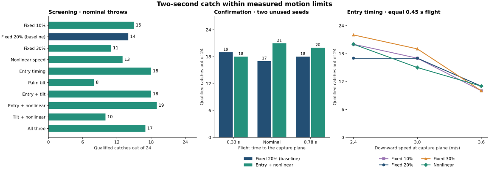

# 入掌时机、掌面方向和非线性速度匹配

本实验延续 xArm7 + LEAP Hand 的随球减速控制。各策略共用两秒保持、25 mm 漂移、实际关节速度和加速度、模型执行器及关节限位的原判据。表中的“合格”表示既接稳又满足运动约束。所有结果来自已知球状态的 MuJoCo 仿真。



## 实际改变了什么

- **闭指时机**：在运动手掌坐标系里，用球心相对位置、相对速度和重力，外推未来 26 ms 内球心穿过捕获平面的时刻。预测横向偏差在 1.25 个球半径内即触发主要闭指。已有接触时，若球越过平面、已开始退出或首触后经过 12 ms，采用接触回退。预成形和闭指控制律沿用原实现。26 ms 是对掌心平面的预测窗口；首次碰到手指的时刻是另一事件，记录的提前量可以超过 26 ms。
- **掌面朝向**：每个候选拦截时刻根据预测入射方向，在初始朝向基础上尝试 0°、4°、8° 的调整，幅度不超过实际入射夹角。先用剩余入射角和倾转幅度的代价选一个目标朝向，再用原带约束的 MPC 求解。这样每个候选时刻仍只解一个 QP。
- **速度比例**：固定 10%、20%、30% 与平滑非线性曲线比较。令 $s$ 为预测拦截时的三维球速（m/s），$x=\mathrm{clip}((s-2.4)/1.2,0,1)$，$\alpha=0.10+0.20x^2(3-2x)$。手掌捕获点的目标速度为 $\alpha\mathbf v_{ball}$。另在首触时测手掌实际速度沿来球的投影，并除以当时球速。末端速度目标是软目标，受七轴运动限制和位置、姿态目标共同影响。

## 同球筛选

10 个候选，810 用于已有轨迹回归，813/814 共 24 球用于筛选（每个种子 12 球）。同一球在共同的规划时刻复用基线超时决定。排序首先比较合格数，再比较保持数，平分取改动较少的版本。

| 策略 | 接稳 | 合格 |
|---|---:|---:|
| 固定 20% 基线 | 14/24 | 14/24 |
| 固定 10% | 15/24 | 15/24 |
| 固定 30% | 12/24 | 11/24 |
| 仅非线性匹配 | 13/24 | 13/24 |
| 入掌预测闭指 + 固定 20% | 18/24 | 18/24 |
| 倾掌 + 固定 20% | 10/24 | 8/24 |
| 入掌预测闭指 + 非线性匹配 | 19/24 | 19/24 |
| 入掌预测闭指 + 倾掌 + 固定 20% | 20/24 | 18/24 |
| 倾掌 + 非线性匹配 | 12/24 | 10/24 |
| 三项组合 | 19/24 | 17/24 |

813/814 上，仅改闭指时机使 6 球从不合格变为合格、2 球退步。加上非线性后，相对旧基线 6 球改善、1 球退步。单独加入倾掌使合格数降到 8/24；本轮测试聚焦近距离、掌心附近的来球。结果不能外推到大侧向角入射。

## 两个独立种子的确认

固定使用筛选胜出的“入掌预测闭指 + 非线性匹配”，对比原“首触后闭指 + 固定 20%”。815/816 未参与选择，每种飞行工况 24 球。此处及等时测速实验均按各策略自己的实测 MPC 求解时间执行超时决定。各行的球来自相同随机几何，跨行有配对关系。

| 到初始捕获平面的飞行时间 | 接稳，基线 → 新版 | 合格，基线 → 新版 | 合格改善 / 退步 | 新版首触实际速度比例中位数 |
|---|---:|---:|---:|---:|
| 0.33 s | 19 → 19 | 19 → 18 | 2 / 3 | 4.1% |
| 原始近距 | 18 → 22 | 17 → 21 | 5 / 1 | 6.5% |
| 0.78 s | 19 → 20 | 18 → 20 | 4 / 2 | 8.9% |

原始近距工况下，配对的首 20 ms 反向净接触冲量差中位数约 +0.0011 N·s。合格数提高与降低净冲量是不同结果。这些均为小样本，不作普适成功率或硬件实时保证。0.33 s 与 0.78 s 工况保持发射位置和原定穿过平面的位置，同时改变准备时间与到达速度。

## 固定飞行时间，单独比较速度比例

817/818 是另外两个随机种子。每一条几何轨迹都在 2.4、3.0、3.6 m/s 三个指定向下速度下测试，每个速度 24 条。对同一轨迹，横向发射位置、穿过初始捕获平面的空间点和 0.45 s 飞行时间固定，通过改变发射高度与初速度来得到所需的下降速度。三个档位沿用相同的 24 组横向几何。控制器读的是仿真中球的当前状态，匹配曲线的输入是预测球速的三维模长；离散档位指定的是初始捕获平面上的竖直分量。

| 指定向下速度（m/s） | 首触闭指 20% | 入掌闭指 10% | 入掌闭指 20% | 入掌闭指 30% | 入掌闭指 + 非线性 |
|---|---:|---:|---:|---:|---:|
| 2.4 | 19 | 20 | 17 | 22 | 20 |
| 3.0 | 15 | 17 | 17 | 19 | 15 |
| 3.6 | 7 | 10 | 11 | 10 | 11 |
| 合计（每列 72 次） | 41 | 47 | 45 | **51** | 46 |

按上述三个速度档等权计数，在相同的入掌闭指策略下，固定 30% 和非线性曲线分别获得 51/72 和 46/72 次合格接球。常规随机来球的独立确认仅直接比较旧基线和入掌闭指加非线性；固定 30% 加入掌闭指是等时实验中的较强候选，其在常规分布上相对于非线性的优劣还需新的同球验证。在最快档位，即使固定目标 30%，实际速度投影比的中位数也只有约 3.2%（仅计规划被接受的 19 球同样约 3.2%）。提高目标权重或比例、改变可达到的末端速度是不同的干预。机器人仍可能在没有接受新计划时与球发生接触，原合格判据会将其记为失败。

## 数据与复现

- [筛选原始 CSV](screening.csv)（360 次）和[独立确认 CSV](confirmation.csv)（144 次）
- [等时速度对照 CSV](equal_flight_speed.csv)（360 次）
- [筛选和确认运行](https://github.com/Diara0430/MEAM5170-Final-Project/actions/runs/45745385372)、[等时速度运行](https://github.com/Diara0430/MEAM5170-Final-Project/actions/runs/45745921729)

从仓库根目录运行。每个输出目录应是新目录。确认阶段读取各自筛选运行的 CSV。

```shell
python -m experiments.approach_ablation --seed 813 --output-dir screen813
python -m experiments.approach_ablation --seed 814 --output-dir screen814
python -m experiments.approach_ablation --seed 815 --output-dir confirm815 --profiles nominal short long --selection screen813/trials.csv screen814/trials.csv
python -m experiments.controlled_speed_catches --seed 817 --vertical-speed 3.0 --output-dir speed817_medium
```
