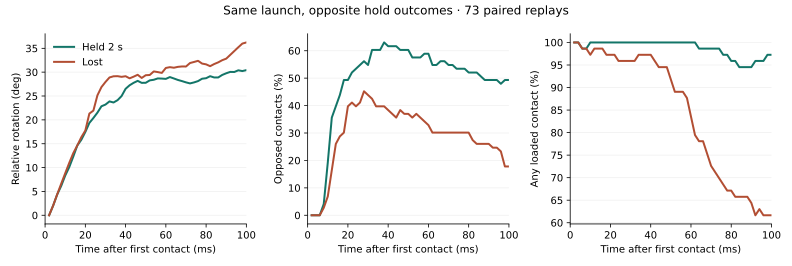

# 长方体触手后 100 ms 的承载与闭指控制

通用演示继续使用普通姿态预测和原闭指。两批独立验证都没有观察到新手部动作同时提高抓稳与七轴合规。最值得跟踪的两个时刻，是首触后 20 ms 的关节加速度和 100 ms 的掌内滚动。

基线为主动滚动拦截的 `pose/original`，与此前的[长方体接取研究](../shape_transfer/README.md)使用相同的 xArm7、LEAP 手、60 g 自旋长方体和原始评分器。三个观测条件依次为正常（2 mm、20 ms）、较差（4 mm、40 ms）、早期带 32 mm 横向偏差后纠正（4 mm、40 ms）。每组方法使用相同的发射、初始自旋和相机噪声。物理抓稳要求主动计划已下发、未落地、0.3 s 过渡后持续接触手指两秒且相对掌心漂移不超过 25 mm。完整合规还要求七轴全程速度 ≤1 rad/s、加速度 ≤4 rad/s²、行程与执行器力矩在模型限值内。

## 触手后什么时候分开

对原来两批共 96 个不同的发射，在三个条件下分别重跑普通姿态版与调整第六轴力臂版，共 576 次。每次都保存 50 个物理步。时间标记表示步末，第一行 +2 ms 已经包含首次碰撞，位移和转角以此行的掌内位姿为零点。每行包含物体相对掌心的三维位置和转角、掌面和四指各自的法向载荷，以及对向支撑标记。首个 100 ms 后继续记录触地、保持阶段指接触首次中断和位置漂移超限的时刻。

承载判据复用仓库的接触分组和 0.02 N 阈值。瞬时对向支撑要求两个不同部位在质心两侧且法向夹角超过 120°，其中可以包含掌面。连续 6 ms 才记作已建立稳定对向支撑。这里的支撑指标用于解释两秒抓稳结果。单个部位的法向载荷与手对物体的矢量合力分别统计。

普通姿态版有 286 次下发主动计划且碰到物体，226 次抓稳，60 次掉落或未满足保持条件。此前对应数据中有 62 次失败，其中 54 次在本次回放也失败。按墙钟时间执行的 20 ms 规划和 2 ms 手臂命令期限，会使重复发射的命令交付和结果发生变化。60 次失败中有 36 次最终触地，48 次出现保持阶段漂移大于 25 mm，两类可重叠。226 次抓稳中有 187 次在头 100 ms 内至少建立过稳定对向支撑，但只有 2 次建立过严格的拇指与其他手指间的对向支撑。

两种手臂方法有 73 对同一发射、同一观测条件、都已下发命令并接触物体，但最终一成一败。下表每格均为“最终抓稳 / 最终未抓稳”，每侧 73 次。对向与承载列表示该时刻的瞬时状态。

| 首触后 | 相对转角中位数 | 有对向支撑的次数 | 仍有承载接触的次数 |
|---|---:|---:|---:|
| 10 ms | 8.3° / 8.8° | 14 / 5 | 73 / 71 |
| 20 ms | 16.9° / 17.8° | 36 / 29 | 73 / 71 |
| 40 ms | 26.5° / 29.2° | 45 / 28 | 73 / 71 |
| 60 ms | 28.6° / 30.9° | 43 / 24 | 73 / 61 |
| 80 ms | 28.7° / 31.6° | 38 / 22 | 70 / 49 |
| 100 ms | 30.4° / 36.2° | 36 / 13 | 71 / 45 |



这指向两侧手部能否在约 40–100 ms 继续承载。相似的早期平移或首次碰掌都不足以单独判断结局。这些回放的两次执行使用不同的手臂策略，组间差异用于提出闭指假设。闭指效果单独用下述干预试验检验。

## 从现成方法取了什么

- 仓库的 `ContactClosure` 已经能从完成的 MuJoCo 物理步识别哪些手指承载和两侧是否稳定支撑。保留 `SphereCageClosure` 的名义指轨迹、真实位置执行器及原关节限制，只在实验条件施加有限的屈指修正。新触觉规则只读取上一个已完成步的接触状态。日志中的真实物体位姿与最终成败只用于评估。[接触检测](../../controllers/contact_closure.py) · [原闭指器](../../controllers/sphere_cage.py) · [新增控制](../../controllers/box_contact_grasp.py)
- Namiki 等在高速手接落球实验中区分接近、闭锁、反弹和保持，并在双指触物时调整手指响应。这里借鉴了按接触阶段控制的思路，测试已承载侧让位、另一侧补抓和丢失支撑后的短时补抓。[论文与图 7](https://ishikawa-vision.org/fusion/HighspeedHand/namiki_iros03_hand.pdf)

## 闭指规则与筛选

标准方法全程使用原闭指器。触觉法在首触后 90 ms 内、尚未建立持续对向支撑时，对已经承载的手指减少屈曲指令，同时让其余手指多闭合一点。当前只有掌面承载时，四指均可向内。建立稳定支撑后逐步撤掉修正。另测按预计到达时刻提前 95 ms 小幅预收指、提前预收指加触觉法，以及检测到已有支撑丢失后补抓 40 ms。所有叠加指令均受位置限位，每个屈曲执行器相对原指令的力矩等效变化上限为 0.45 N·m。这个界限只适用于叠加的执行器指令，接触力另外实测。

开发集 1121–1123 的 24 个发射，每个发射在三种观测下各运行五种方法。筛选优先保留合规总数至少达到原版的候选，再按抓稳总数、合规总数、表现最弱条件的抓稳数和预设顺序排列。各行分母 72，三种观测复用同一批 24 个发射。

| 闭指规则 | 抓稳 | 完整合规 |
|---|---:|---:|
| 原版 | 55 | 37 |
| 首触后触觉调节 | **57** | **40** |
| 提前预收指 | 57 | 39 |
| 提前预收指加触觉调节 | 56 | 39 |
| 丢失支撑后短时补抓 | 55 | 39 |

触觉调节开发集救回 4 次、丢掉原本能抓稳的 2 次。筛选数据用于确定进入独立验证的候选。独立验证同时比较原手臂、缩短第六轴力臂两种运动，每种再搭配原闭指、触觉影子和实际触觉调节。影子执行相同的触觉计算并保留原执行器指令。

## 首触触觉调节的独立验证

1131–1136 的 48 个全新发射，在三种观测下各运行六个组合，共 864 次。下表和后续两表每格都是“抓稳 / 抓稳且七轴完整合规”的次数。每个观测条件分母为 48，合计分母为 144。各表格的不同批次具有自己的原版对照。

| 手臂 | 手部 | 正常 | 较差 | 偏差纠正 | 合计 |
|---|---|---:|---:|---:|---:|
| 普通姿态 | 原闭指 | 38 / 35 | 38 / 27 | 35 / 25 | 111 / 87 |
| 普通姿态 | 实际触觉调节 | 37 / 34 | 38 / 26 | 31 / 21 | 106 / 81 |
| 普通姿态 | 触觉影子 | 37 / 34 | 36 / 24 | 36 / 24 | 109 / 82 |
| 调整第六轴力臂 | 原闭指 | 36 / 31 | 36 / 30 | 34 / 24 | 106 / 85 |
| 调整第六轴力臂 | 实际触觉调节 | 34 / 29 | 35 / 25 | 33 / 23 | 102 / 77 |
| 调整第六轴力臂 | 触觉影子 | 37 / 31 | 35 / 29 | 34 / 25 | 106 / 85 |

在普通手臂上，真实触觉动作在 139/144 次运行中下发，救回 6 次、丢掉原先能抓住的 11 次。第六轴调整版同样在 139/144 次运行中下发，救回 6 次、丢掉 10 次。普通手臂在有早期观测偏差时回退最多，35 次抓稳降到 31 次。普通手臂的影子也从 111 次变为 109 次，表明墙钟期限会影响小幅的结果差异。

在普通手臂两种闭指均抓稳的 100 对上，首触后 20 ms 手对物体合力的峰值差中位数为 0 N，沿来物反方向的冲量差中位数为 −0.131 mN·s，原版这一冲量的中位数约 291 mN·s。调整第六轴后，96 对双方抓稳的相同发射上，峰值差仍为 0 N，冲量差中位数为 −0.069 mN·s。力和冲量仅在双方均抓稳的样本上作这个比较。

普通姿态配原闭指抓稳但未完全合规的 24 次全部出现加速度超限。其中 23 次在首触后 20 ms 就超过 4 rad/s²，21 次的首次碰撞窗口超限涉及第六轴。这批 24 次的速度、行程与力矩均在要求内。另看普通姿态已下发且触及物体的 139 次，111 次抓稳者与 28 次失败者在首触法向相对速度上的中位数接近（4.66 与 4.64 m/s），到 +100 ms 的掌内位移中位数分别为 18.5 与 33.8 mm，相对转角为 25.6° 与 53.0°。这给出了两个可分别验证的目标，即首次碰撞对第六轴的扰动，以及随后的掌内滚动。

## 中指和无名指在触物前的弯曲角度

掌面、中指和无名指在诊断回放中经常承载。这里沿用现有提前 200 ms 开始、持续 120 ms 的手指轨迹，只将中指和无名指各一个屈曲关节的末端参考从 0.30 rad 调到 0.18 rad 或 0.42 rad。运动仍使用模型执行器。首触后继承上一物理步的指关节位置和速度参考，继续原来的闭指轨迹。该试验独立于上面的首触后触觉规则。

第一批使用 1141–1146 的 48 个全新发射，共 432 次。两指内收在偏差纠正条件多抓稳 5 次、多合规 6 次，在正常观测少抓稳 2 次、少合规 3 次。按三条件合计，两指内收救回 9 次、丢掉 5 次，调整幅度固定后进入下一批复核。

| 手臂 | 手部 | 正常 | 较差 | 偏差纠正 | 合计 |
|---|---|---:|---:|---:|---:|
| 普通姿态 | 原闭指 | 36 / 32 | 34 / 25 | 30 / 20 | 100 / 77 |
| 普通姿态 | 两指张开 | 34 / 30 | 34 / 24 | 32 / 21 | 100 / 75 |
| 普通姿态 | 两指内收 | 34 / 29 | 35 / 24 | 35 / 26 | 104 / 79 |

第二批将内收幅度固定为 +0.12 rad，用 1151–1156 的 48 个新发射同时复核两种手臂，各自保留原版、内收和只计算内收的影子对照。下表共 864 次。两种手臂都在全部 144 次内收试验实际发出预形指令，两个影子都没有下发任何额外的预形指令。

| 手臂 | 手部 | 正常 | 较差 | 偏差纠正 | 合计 |
|---|---|---:|---:|---:|---:|
| 普通姿态 | 原闭指 | 39 / 33 | 35 / 23 | 42 / 28 | 116 / 84 |
| 普通姿态 | 两指内收 | 39 / 35 | 33 / 21 | 40 / 26 | 112 / 82 |
| 普通姿态 | 两指内收影子 | 37 / 31 | 33 / 20 | 42 / 28 | 112 / 79 |
| 调整第六轴力臂 | 原闭指 | 37 / 27 | 38 / 26 | 40 / 26 | 115 / 79 |
| 调整第六轴力臂 | 两指内收 | 36 / 30 | 39 / 26 | 38 / 26 | 113 / 82 |
| 调整第六轴力臂 | 两指内收影子 | 37 / 28 | 40 / 25 | 40 / 26 | 117 / 79 |

普通手臂在三种条件合计救回 6 次、丢掉 10 次。先前在偏差纠正时由 30/48 升到 35/48，这一批从 42/48 降到 40/48，提升没有复现。把两批各自的普通手臂原版和两指内收结果分别相加，两者都是 216/288 次抓稳、161/288 次完整合规。这个描述性合计包含筛选用的首批，独立验证应看第二批。第六轴调整版上，内收让完整合规从 79 增至 82，但抓稳从 115 减至 113，仍有取舍。普通手臂 106 对双方抓稳样本的前 20 ms 峰值力差中位数为 −0.00018 N，反向冲量差中位数为 −0.00043 mN·s。

## 演示配置与后续问题

本轮保留 `--method pose --grasp original` 为通用长方体演示。姿态和自旋预测继续用于主动接取。首触后的短时调节以及手指提前内收都可通过参数单独复现。若继续提高七轴合规率，可以固定预测接点和末速，在触物前绕掌面法向小幅转腕，检验盒子在掌内的滚动和第六轴在头 20 ms 的加速度峰值是否同时减小。用新的发射分别记录抓稳和完整合规，再决定是否纳入演示。

## 查看与复现

[同一发射的成功与掉落曲线](paired_contact.svg) · [示例逐步接触数据](example_frames.csv) · [现有长方体运动回放](../shape_transfer/catch.gif)

| 阶段 | 仿真次数 | 逐次数据和运行 |
|---|---:|---|
| 旧发射的接触回放 | 576 | [逐次](contact_replay.csv) · [运行](https://github.com/Diara0430/MEAM5170-Final-Project/actions/runs/45883345490) |
| 五种闭指筛选 | 360 | [逐次](screen.csv) · [运行](https://github.com/Diara0430/MEAM5170-Final-Project/actions/runs/45883693628) |
| 触觉闭指独立验证 | 864 | [逐次](confirmation.csv) · [运行](https://github.com/Diara0430/MEAM5170-Final-Project/actions/runs/45884193495) |
| 两指预形比较 | 432 | [逐次](preshape.csv) · [运行](https://github.com/Diara0430/MEAM5170-Final-Project/actions/runs/45884499776) |
| 两指内收独立复核 | 864 | [逐次](preshape_confirmation.csv) · [运行](https://github.com/Diara0430/MEAM5170-Final-Project/actions/runs/45889162793) |

共 3,096 次完整仿真，对应 264 个不同的物理发射。诊断的 28,800 帧按观测条件提供，解压后可按种子、案例、手臂策略和触手后时间对应到评分。[正常](frames_normal.csv.gz) · [较差](frames_noisy.csv.gz) · [偏差纠正](frames_corrected.csv.gz)

在仓库根目录安装 `scene_setup/requirements.txt`。批量仿真用单线程 OpenBLAS，手部控制器和评分器都来自同一份代码。第二条命令可生成带物体和机器人运动的 GIF，需要可用的 MuJoCo 渲染后端和 Pillow。重复执行可能因规划计算耗时而改变个别结果，上述 CSV 保存了本次正式运行的结果。

```bash
python -m experiments.box_contact_window --seeds 1131 --profile normal --conditions pose/original pose/tactile axis_lever/tactile --output-dir runs/contacts --frames
python -m experiments.shape_replay --seed 1151 --case 0 --profile corrected --method pose --grasp middle_ring_curled --output-dir runs/box_movie
```
