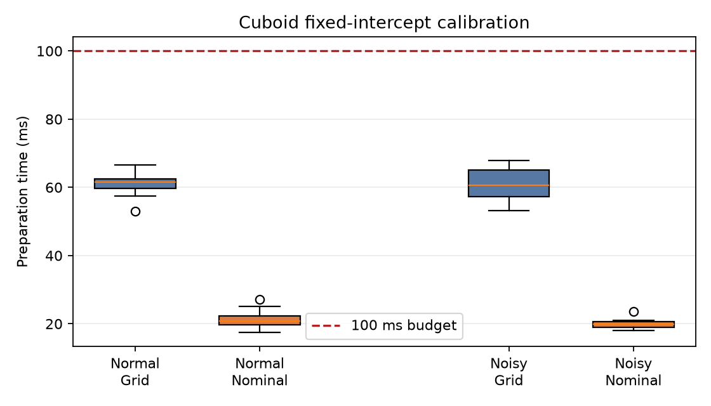

# Fixed-intercept preparation: speed-grid profiling

## Question and method

The original `CalibrationMPC` first selects an observation-derived intercept and then solves a fixed-point constrained problem for 15 grid speeds (0 to 0.70 m/s at 0.05 increments) plus the nominal speed. Its `mid` label chooses the certified level nearest the midpoint of the feasible speed span. This experiment compares that full grid with `FastCalibrationMPC`, which tests only the nominal speed from the same anchor. Both invoke the existing QP, stopping feasibility, nonlinear endpoint and velocity checks; both must finish within the existing 100 ms reservation. A missed deadline remains a failure. The single-speed method does **not** certify low/high or the full feasible speed span, and can fail when some other grid speed is feasible. It is an experimental method, not the default planner.

Both methods use the same observation process and launch seed, rotate execution order, use the original hand closure, and run a zero-degree fixed-intercept catch. Catch results are influenced by their potentially different requested speeds and real wall-clock deadlines; this is not a pure speed-of-code comparison at identical terminal speed. Profiling wraps the underlying QP calls and records anchor and speed-solve times separately. Total preparation time refers only to the final attempt that found an anchor, while anchor solve timing may include prior failed attempts; do not sum their medians. A `no_feasible_anchor` run has no timed completed preparation and is excluded from preparation-time summaries, not counted as 0 ms.

## Results

Two new seeds (1202 and 1203), eight launches per seed, are evaluated under normal and noisy observations. Each profile reuses the same 16 physical launches; there are 64 full catch simulations plus fixture preparation. The table shows counts out of 16 per profile; medians use the 12 runs that found an anchor in each cell.

| Profile | Method | Ready | No anchor | Deadline timeout | Held | Held and compliant | Median preparation |
|---|---|---:|---:|---:|---:|---:|---:|
| Normal | Full grid | 12 | 4 | 0 | 9 | 5 | 61.61 ms |
| Normal | Nominal only | 12 | 4 | 0 | 10 | 10 | 20.74 ms |
| Noisy | Full grid | 12 | 4 | 0 | 10 | 7 | 60.59 ms |
| Noisy | Nominal only | 12 | 4 | 0 | 9 | 6 | 19.86 ms |



The full grid made 16 speed-constrained solves per ready fixture, compared with one for the nominal method. Median recorded speed-solve time fell from 42.81 to 2.92 ms in normal observations and from 42.58 to 2.82 ms in noisy observations. Median paired preparation-time differences were 40.67 and 40.50 ms respectively. All 24 pairs that were ready in both methods had identical stored fixed points and times. Their requested speeds differed: the median absolute difference was 0.1025 m/s normal and 0.1447 m/s noisy. Therefore catch and compliance differences cannot be attributed to computational optimization alone.

This batch had **zero baseline deadline misses**, so it does not demonstrate a lower timeout rate. The earlier high timeout count occurred in a different run and cannot be directly used as a paired baseline. Wall-clock times depend on hardware, operating-system scheduling, profiling and machine load; no hardware real-time guarantee follows. Small samples and differing speed requests preclude claiming superior catch or compliance performance. No machine learning is used.

## Reproduce

From the repository root:

```powershell
$env:OPENBLAS_NUM_THREADS='1'
python -m experiments.calibration_benchmark --seed 1202 --profile normal --output-dir runs/calib_normal_1202
python -m experiments.calibration_benchmark --seed 1202 --profile noisy --output-dir runs/calib_noisy_1202
python -m experiments.calibration_benchmark --seed 1203 --profile normal --output-dir runs/calib_normal_1203
python -m experiments.calibration_benchmark --seed 1203 --profile noisy --output-dir runs/calib_noisy_1203
```

The four run directories contain all per-trial timing, feasibility, applied-plan and catch fields. The independent pilot is retained separately and excluded from the table. Next benchmark under representative measured CPU load and investigate deadline distributions, and separately test whether a fixed requested speed can be preserved while avoiding redundant solver setup; then run larger independent angle tests before adopting a new policy.
