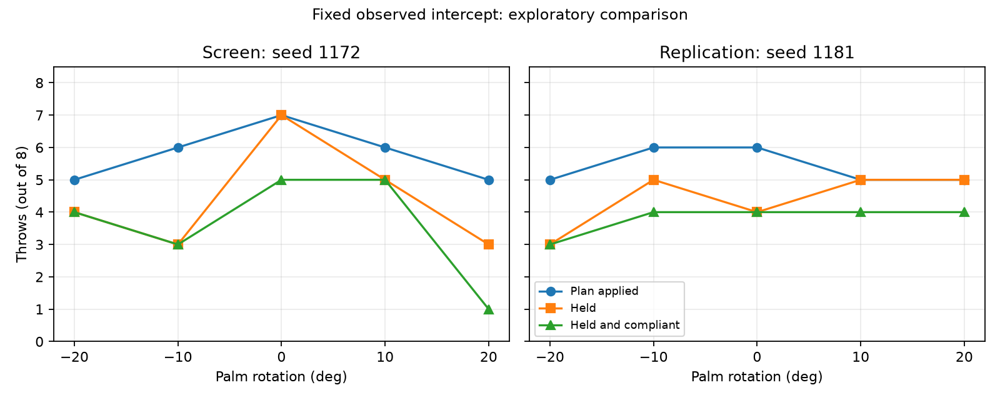

# Fixed-intercept palm rotation: exploratory cuboid study

The fixture is generated once from delayed noisy observations for each throw, then reused across five palm-normal rotations. Each variant requests the same intercept point, intercept time, estimated incoming velocity, and scalar palm-speed target along the incoming direction. A constrained QP requests speed within 0.015 m/s in its linear model; a nonlinear terminal-Jacobian check allows 0.025 m/s deviation. These are planned targets, not guaranteed identical contact velocities: actuator dynamics, contact timing and deadline misses can change realized values. The CSV records observed contact speed and orientation error.

The fixture's speed grid and feasibility certificate are built for the original orientation, not jointly certified for all five angles. Every angle must independently find and deliver a feasible plan. A missing fixture or an undelivered plan is reported separately from a failed hold. Rotations are applied before flight via the desired orientation; the object is never forced into the hand. All runs use the original closure, force-limited actuators, normal observation profile and classical model-based control.

## Results

Each column uses eight matched throws. `ready` describes successful common fixture preparation; `applied` is an actuator-side accepted active plan. The original evaluation marks held only when a plan was applied and the two-second retention test passed. Complete compliance also includes joint position, speed, acceleration and actuator limits.

| Angle | Seed 1172 ready / applied / held / compliant | Seed 1181 ready / applied / held / compliant |
|---:|---:|---:|
| 0° | 7 / 7 / 7 / 5 | 6 / 6 / 4 / 4 |
| -10° | 7 / 6 / 3 / 3 | 6 / 6 / 5 / 4 |
| +10° | 7 / 6 / 5 / 5 | 6 / 5 / 5 / 4 |
| -20° | 7 / 5 / 4 / 4 | 6 / 5 / 3 / 3 |
| +20° | 7 / 5 / 3 / 1 | 6 / 5 / 5 / 4 |



The 1172 set contains one `no_certified_speed` fixture; the 1181 set contains two `no_feasible_anchor` fixtures. Contact may occur with a parked hand even when no active plan was applied; it is not counted as an active catch. Data for contact window acceleration, peak resultant force and opposing impulse, physical hold, actual contact speed, orientation error, and relative 100 ms displacement and rotation are in the trial CSVs.

## Interpretation and limitations

The earlier unrestricted rolling-plan screen favored -10° and -20° in its small sample; that ranking did not hold here. No candidate is established as better or promoted to default. Both batches are small and cover normal observations only. Differences in delivered plans and contact conditions mean raw force or rotation medians computed over different surviving throws are not causal paired comparisons. Actual contact speed and time are measured outcomes, not locked values; the held-out batch is a separate exploratory replication, not a prespecified winner confirmation. Real wall-clock planning and command deadlines can cause variation across reruns. The 100 ms relative-motion measurement starts at the first recorded post-contact frame and measures orientation change, not pure rolling without slip.

Next compare same-throw runs with delivered plans and close actual contact speeds, use a larger independent sample including noisy observations, and analyze joint-6 acceleration and paired 20 ms impulse alongside 100 ms relative motion. Explicitly report failed fixtures and infeasible angles. Also consider jointly certifying a shared speed across all orientations.

## Reproduce

From the repository root with the scene dependencies installed:

```powershell
$env:OPENBLAS_NUM_THREADS='1'
python -m experiments.fixed_angle_study --seed 1172 --cases 8 --profile normal --output-dir runs/fixed_angle_1172
python -m experiments.fixed_angle_study --seed 1181 --cases 8 --profile normal --output-dir runs/fixed_angle_1181
```

Per-throw seed 1172: [screen CSV](screen/trials.csv). Seed 1181: [replication CSV](replication/trials.csv). Five rows per throw have been checked for identical fixed point, time, requested speed and fixture status.
