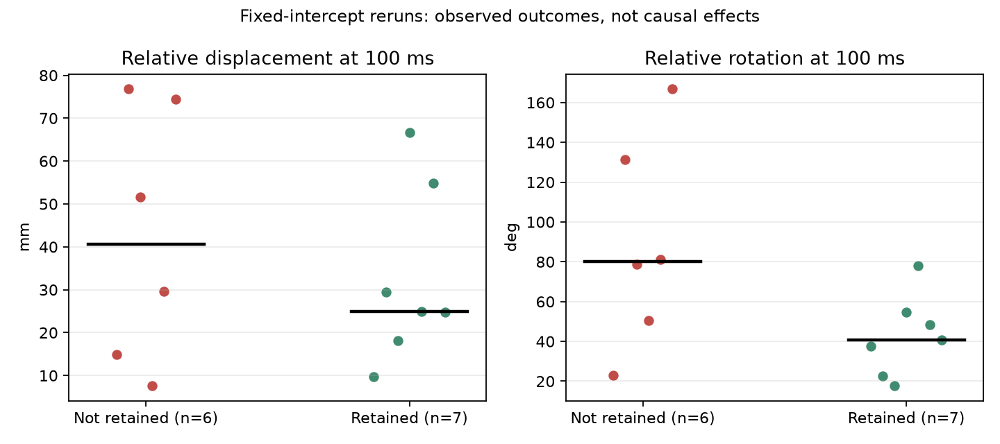

# Fixed-intercept cuboid contact failure audit

## Design and reproduction boundary

The source cohort comprises all 13 scoped-controller trials that applied an active plan in `results/scoped_load/validload_noisy_1251/trials.csv` and `validload_noisy_1252/trials.csv`. Those original trials used four synthetic CPU workers. This audit reruns the same launches and noisy-observation seeds with the same scoped fixed-intercept controller, original hand closure, no deliberately added workers, and extra frame-by-frame diagnostic code. Wall-clock planning and command deadlines remain active. Diagnostic overhead, workload and scheduling can change control delivery and outcomes, so these are **new reruns**, not exact replay of the earlier physical trajectories. No counterfactual causal claims follow.

Seven of the source trials were not retained and six were retained. In the audit, six again failed and seven were retained; seed 1252 case 3 changed from failure to retention. All 13 audit trials applied an active plan. The run logs both source and rerun outcomes.

## Observations in these 13 reruns

| Rerun outcome | Number | Median relative translation at 100 ms | Median relative rotation at 100 ms | Stable opposition in first 100 ms | Subsequently touched floor |
|---|---:|---:|---:|---:|---:|
| Not retained | 6 | 40.6 mm | 80.0° | 2 | 6 |
| Retained | 7 | 24.9 mm | 40.9° | 3 | 0 |

Translation and rotation are measured relative to the first recorded post-contact frame, typically +2 ms, not true pre-impact state. The opposition indicator uses contact groups and the existing 0.02 N load threshold with six consecutive milliseconds; it may include palm contact. Lack of opposition is not a proven failure cause: only 3/7 retained reruns met the same strict criterion in this short window. Rotation is not by itself evidence of rolling or sliding. These are small observational groups with varying launches; differences cannot establish that one motion caused failure.

All six failed reruns subsequently touched the floor, at 472–694 ms after first contact. At the start of the 300 ms evaluation window, five lacked finger contact; the sixth first showed a gap at 316 ms. All six exceeded 25 mm drift after the evaluation window began. These markers describe the recorded outcome, not the exact instant support was lost: contact gaps before 300 ms are recorded only during the first 100 ms using the loaded-contact indicator. Two failed reruns had early stable opposition, so a brief contact configuration alone did not ensure later retention.

Seed 1252 case 5 is a useful visible example: its 100 ms relative displacement was 74.5 mm and orientation change 166.9°, and its recorded mapped contacts in the first 300 ms involved the palm group only. It eventually touched the floor. This is a single example, not a universal mechanism.



## Data interpretation

`trials.csv` records source and rerun outcomes, support and failure events, impact metrics and 100 ms relative motion. `frames.csv` records every 2 ms from first contact through 300 ms: mapped contacts, sum of normal forces, sum of individual tangential-force magnitudes, maximum approximate friction utilization, object velocity projection along its pre-contact world velocity, and all 16 hand actuator joint positions, velocities and target commands. Contact group IDs: -1 palm, 0 index, 1 middle, 2 ring, 3 thumb. The velocity projection is in world coordinates and is not a contact-normal coefficient of restitution.

The utilization value is `||tangential force||/(mu_1*normal force)` for mapped contacts with normal force at least 0.02 N. It is an approximate isotropic diagnostic; anisotropic/pyramidal cone modeling and frame selection affect interpretation. A value near one does not, by itself, establish physical sliding. Summed contact magnitudes are not the net force. Peak forces depend on MuJoCo timestep, stiffness and modeled material parameters and should not be presented as measured physical robot forces.

## View and reproduce

[Recorded example GIF](1252_5_noisy.gif) shows the saved rerun (two views); [English relative-motion plot](contact_outcomes.png). All 13 `*_replay.json.gz` files contain saved model positions at 20 ms intervals. The viewer plays saved frames; it does not recompute physics. From the repository root:

```powershell
& 'D:\test code\.venv\Scripts\python.exe' -m experiments.view_cuboid_audit results/fixed_failure_audit/1252_5_noisy_replay.json.gz --speed 0.25 --loop
```

Close the MuJoCo viewer window to exit. To collect this cohort again (results can differ because of deadlines and diagnostic overhead):

```powershell
$env:OPENBLAS_NUM_THREADS='1'
python -m experiments.fixed_contact_failure_audit --sources results/scoped_load/validload_noisy_1251/trials.csv results/scoped_load/validload_noisy_1252/trials.csv --output-dir runs/fixed_failure_audit
```

Next compare contact-conditioned interventions against a matched baseline on new launches, preserving source seeds and measuring both recovery and regressions. Specifically test whether forming sustained two-sided support earlier can reduce the 40–100 ms relative movement without increasing impact or violating joint limits; include a shadow/instrumentation control and an independent confirmation set. Do not change the default controller based on this observational cohort alone. No machine learning is used.
