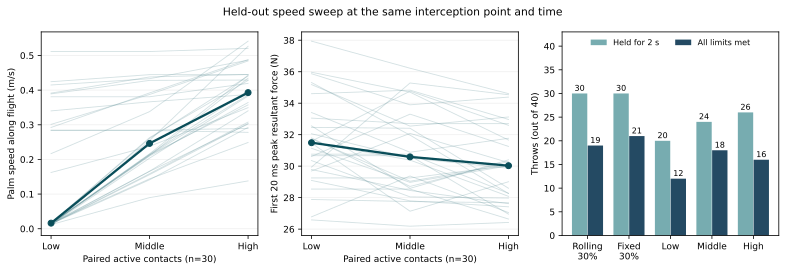
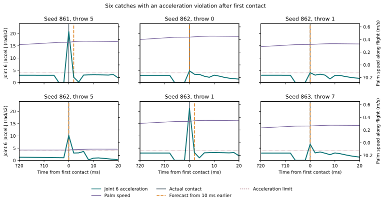

# 固定接点与到达时刻的接球速度实验

在 40 个独立长抛上，固定接点后，30 球在低、中、高三个速度档都执行了计划并碰到球。高档相对低档在其中 24 球降低了首次接触后 20 ms 的手对球合力峰值，逐球差值中位数为 −1.65 N。三个硬速度档中，完整通过最多的是中档（18/40）；固定同一端点、保留原来的 30% 软速度目标得到 21/40。



## 同一个球如何比较多个速度

1. 沿用 xArm7、LEAP 手、60 g 球和延迟三维位置观测。标准条件每 20 ms 采样，各轴噪声标准差 2 mm，传输延迟 20 ms。发射位置和初速只用于初始化 MuJoCo。
2. 各策略共享观察前缀。最早在 0.26 s 使用重力拟合得到的球状态，从七个高度里选一个可行端点，并固定其世界坐标和绝对到达时刻。给可行速度搜索预留 100 ms，可按预算重试。第一次下发参考另需一个 20 ms 周期。实际执行仍从当时测得的机械臂状态重新求解。
3. 在该点尝试 0–0.70 m/s、步长 0.05 m/s 的沿来球速度，以及原参考的预计终速。每一档都必须通过七轴位置、速度、规划加速度、力矩、采样碰撞、终点位置和可制动行程检查。优化的线性速度约束容差为 0.015 m/s，随后通过非线性终点雅可比复核，允许 0.025 m/s 偏差。这给出本次搜索认证的速度集合；尚未求连续可行域的数学边界。
4. 低、高档取认证集合两端，中档取最靠近两端中点的认证值。不同抛球的目标速度可以不同，集合较小时三个标签可能对应相同或接近的目标。机械臂实际能否达到该速度另按首次接触时的实测掌心速度评价。所有执行过的锁定参考都核对了世界坐标和绝对到达时刻。
5. 四组固定端点策略共用同一条件；另设原有实时更新接点的七高度控制器作为参照。所有策略采用相同的快速接触预测、限时力矩修正、触觉闭指和判据。低层命令超过 2 ms、滚动规划超过 20 ms 时沿用原命令。停止距离和关节限值与前一轮相同。“主动保持”要求实际执行计划，触球后经过 0.3 s 过渡，再连续两秒维持手指接触且相对漂移不超过 25 mm。完整通过还要求全程关节速度不超过 1 rad/s、加速度不超过 4 rad/s²、位置和力矩合规。

## 速度对结果的影响

| 策略 | 开发 24 球，主动保持 / 完整通过 | 独立 40 球，主动保持 / 完整通过 |
|---|---:|---:|
| 实时更新接点，30% 软目标 | 20 / 14 | 30 / 19 |
| 固定接点，30% 软目标 | 21 / 14 | 30 / 21 |
| 固定接点，低档 | 13 / 7 | 20 / 12 |
| 固定接点，中档 | 16 / 11 | 24 / 18 |
| 固定接点，高档 | 18 / 13 | 26 / 16 |

开发组为种子 871–873，独立组为 881–885，每个种子 8 球。独立组中 6 球未找到共享可行接点，4 球选到了接点但硬速度网格未找到合格参考；全部计入分母。30 球三个硬速度档均产生主动接触，其中 25 球至少有三个认证速度。23 球实测高低档相差至少 0.05 m/s。

| 30 球逐球配对后的组内中位数 | 低档 | 中档 | 高档 |
|---|---:|---:|---:|
| 沿实际来球方向的掌心速度（m/s） | 0.016 | 0.246 | 0.393 |
| 前 20 ms 合力峰值（N） | 31.49 | 30.59 | 30.03 |
| 前 20 ms 反向冲量（N·s） | 0.290 | 0.285 | 0.277 |

同一球由低改高的速度差中位数为 +0.282 m/s，峰值力差为 −1.65 N，早期冲量差为 −0.0135 N·s。只看三档都主动保持两秒的 17 球，高档在其中 13 球降低峰值力。上述数据描述首 20 ms 的负载。固定参考端点允许实际第一次碰到手的时刻和接触部位随轨迹变化。

用开发组按完整通过数、主动保持数、共同保持球的峰值力依次选择规则。候选包括固定三档、30% 软目标和在估计球速 5.2 m/s 处分档的两条规则。开发组选出固定接点 30% 软目标，随后冻结规则。独立组若事后逐球择优，四种固定端点策略合计有 29/40 球至少一次完整通过。这个数使用了结果标签，仅用于估计继续研究逐球选速的空间。

另一批 24 球（891–893）将噪声增至 4 mm、延迟增至 40 ms。锁定接点的原软目标主动保持 15/24、完整通过 10/24；实时更新接点为 21/24 和 9/24。这批球的发射种子与标准验证组不同。下节使用相同发射种子直接比较两个观测条件。

## 仅在有速度选择余量时改用中档

开发组观察到另一条候选规则：若认证高低档间隔至少 0.15 m/s，执行中档；其他情况执行固定接点的 30% 软目标。该规则在开发组为 15/24 完整通过、19/24 主动保持，锁定软目标分别为 14/24 和 21/24。此次额外选择使用了开发结果，因此再取全新种子 911–914 验证。两个传感器条件使用同样的 32 个发射状态以及配对的噪声随机数；噪声幅度与延迟一起变化。

| 32 球，主动保持 / 完整通过 | 标准观测（2 mm、20 ms） | 较差观测（4 mm、40 ms） |
|---|---:|---:|
| 实时更新接点，原软目标 | 26 / 20 | **28 / 16** |
| 固定接点，原软目标 | 25 / **23** | 20 / 12 |
| 有余量时改用中档 | **27** / 21 | 15 / 13 |

规则分别对 18 和 17 球实际选择中档。规则与对照选择同一动作时，复用该次模拟结果。正常观测时，规则相对固定软目标让 2 个原失败球合格、4 个原合格球失去资格。较差观测时分别为 3 和 2 球，主动保持数同时减少 5。现阶段保留原软目标；观察较差时优先保留持续更新接点的能力。

## 六球复盘及第 6 关节修正



使用 861–863 的全部 24 个发射作为复盘，重点对照上一轮归档中保持成功、接触后 20 ms 加速度超限的六球。提前 10 ms 取当时已收到的球观测，使用当时机械臂状态和最近的驱动命令推演未来 30 ms 内的首次几何接触。这个诊断预测在独立状态中运行，不参与控制。每个物理步长为 2 ms。正的掌心速度表示沿拟合来球方向运动。

| 种子 / 球号 | 归档 / 本次 20 ms 峰值（rad/s²） | 实际减预测接触时间（ms） | 首个超限步涉及的关节 | 接触前 10 ms 掌心速度（m/s） |
|---|---:|---:|---|---:|
| 861 / 5 | 20.99 / 20.75 | −2 | 4、6 | +0.341 |
| 862 / 0 | 4.81 / 4.81 | 0 | 6 | +0.425 |
| 862 / 1 | 4.06 / 4.06 | 0 | 6 | +0.310 |
| 862 / 5 | 10.14 / 10.14 | 0 | 4、6 | −0.115 |
| 863 / 1 | 21.07 / 21.07 | −2 | 4、6 | +0.325 |
| 863 / 7 | 17.49 / 6.61 | 0 | 6 | +0.254 |

六球的首个超限步和最大峰值都落在首次触球步，最大分量都来自第 6 关节。两球实际触球早一个仿真步，另外四球落在预计的步内，步内误差仍无法分辨。重跑时继续计真实求解耗时，因此能复现超限关节、阶段和方向，峰值幅度可变。

额外保持原有七高度滚动规划，对预计入手的球进行 −1、0、+1 ms 三种相位预测。在 2 ms 截止时间内，仅尝试修正第 6 关节力矩；候选需降低该轴的最坏预测加速度，并限制其他轴的代价。对 861–863，原版与修正版均主动保持 17/24，完整通过分别为 11/24 与 10/24。对独立种子 901–903，两版均保持 23/24，完整通过的同为 19 个球，逐球通过结果完全相同。该项目前仅作为诊断实验。

## 数据和复现

| 实验 | 归档 | 运行 |
|---|---|---|
| 速度筛选及独立验证 | [开发](development.csv) · [标准验证](validation.csv) · [较差观测验证](noisy_validation.csv) | [运行记录](https://github.com/Diara0430/MEAM5170-Final-Project/actions/runs/45763485250) |
| 认证速度区间规则 | [配对结果](band_rule.csv) | [相同发射、两种观测条件](https://github.com/Diara0430/MEAM5170-Final-Project/actions/runs/45764100253) |
| 首次接触复盘 | [24 球汇总](onset_audit.csv) · [六球逐步时序](onset_frames.csv) | [全部诊断帧](https://github.com/Diara0430/MEAM5170-Final-Project/actions/runs/45763238365) |
| 第 6 关节力矩修正 | [配对结果](wrist_guard.csv) | [旧案例与独立验证](https://github.com/Diara0430/MEAM5170-Final-Project/actions/runs/45763708783) |

各 CSV 保留全部抛球。速度为首次接触时掌心沿实际球速方向的分量，单位 m/s；冲量是手对球的合力在首次碰手前来球反方向上的积分。档位可行性是估计轨迹在模型中的检查结果，稳定抓持、实际关节约束和限时交付另行测量。以上均为 MuJoCo 模拟结果。

```sh
python -m pip install -r scene_setup/requirements.txt
python -m experiments.onset_audit --seed 862 --output-dir local/onset862
python -m experiments.fixed_speed_sweep --seed 881 --output-dir local/speed881
python -m experiments.fixed_speed_sweep --wide-mid --stress --seed 911 --output-dir local/noisy911
python -m experiments.wrist_impact --seed 901 --output-dir local/wrist901
python -m experiments.plot_fixed_speed results/fixed_speed
```
