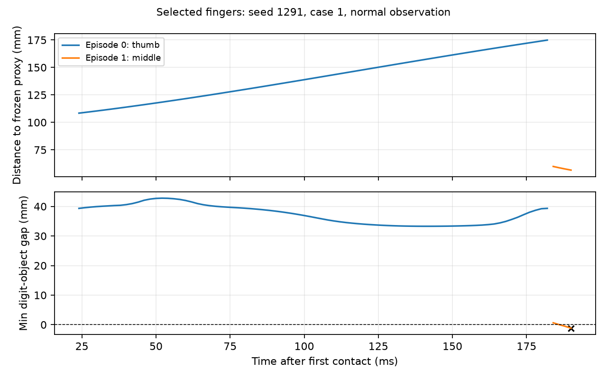

# Geometry-selected finger follow-up audit

## Question and data

The prior geometry rule did not improve retention on its independent confirmation launches. This diagnostic reruns those two seeds (1291 and 1292), eight cuboid throws each, under normal and noisy observations and with original, shadow and geometry methods: 16 physical launches, 32 launch/observation combinations and 96 scoring simulations. These are the **same confirmation launches**, not a further independent test. Each trial retains measured wall-clock deadlines; additional 2 ms frame recording and exact distance calculations can alter scheduling and control outcomes. Original, shadow and geometry are separate runs, not a synchronized counterfactual.

The diagnostic subclass saves the contact information available **before** each hand command and the observed state after the step. A selection episode is a contiguous run in which one finger is selected. At the episode start, the heuristic target (`contact point + 45 mm × weighted normal`) is frozen in world coordinates for offline comparison. We record fingertip-body origin distance to that frozen point and the minimum distance from any mapped collision geometry of that digit to the true cuboid geometry. The latter uses MuJoCo ground truth **only in the recorder**, never in the controller. Neither distance is a physical hardware measurement. Movement relative to a fixed world point includes arm and hand motion; the object and live controller target can move independently.

The existing controller's loaded group uses a 0.02 N normal-force threshold from the prior completed step. After each episode we inspect up to 50 ms more of recorded post-step groups for the selected digit, including periods after it is no longer selected. Three consecutive loaded samples at 2 ms intervals count as 6 ms of observed loaded contact. This is finger-level contact anywhere on the digit, not necessarily a fingertip or two-sided grasp. Later contact can arise from the nominal controller or other dynamics; it cannot automatically be attributed to the geometry assist. All 47 geometry episodes had the full 50 ms follow-up recorded.

## Results

| Observation | Geometry trials with active plan | Trials with a selected-finger episode | Selected trials where that finger became loaded during the episode or within 50 ms | Selected trials with 6 ms consecutive loading in that window |
|---|---:|---:|---:|---:|
| Normal | 14/16 | 8/16 | 3/8 | 3/8 |
| Noisy | 15/16 | 10/16 | 5/10 | 5/10 |

Across those trials the rule created 24 selection episodes in normal observation and 23 in noisy observation. A selected digit became loaded during or within 50 ms after **7/24** and **6/23** episodes, respectively. Episodes within one throw are correlated and may count the same later contact, so they are not independent tests. Four of 24 and nine of 23 episodes reached at least 5 mm closer to their own frozen proxy at some recorded instant. This descriptive threshold does not establish that the hand control caused the movement or that the moving cuboid was reached. Median minimum selected-digit-to-object geometry gaps during the episodes were 7.9 mm and 14.4 mm; these include all selected episodes, including those with contact, and are model-dependent.

The per-command gate reasons are logged as mutually exclusive, in priority order: `outside_window`, `no_loaded_contact`, `ambiguous_normal`, `opposing_normals`, `no_digit_selected`, and `selected`. A `no_digit_selected` frame can include waiting for the 40 ms reselection interval; it does not prove that no finger was physically reachable. Categories count 2 ms frames rather than independent launches. Full per-case and per-episode counts are in `analysis/cases.csv` and `analysis/episodes.csv`.

The comparison shadow also selects fingers and measures distances but issues no extra geometry commands. Its geometry and outcome can differ because the two runs use separate physics and deadline decisions. Under normal observation it had 24 episodes and 7 loaded by follow-up; under noisy observation, 26 episodes and 6 loaded. These counts alone do not establish a causal effect of the assist.

The reruns matched the prior confirmation's held/not-held outcome for each of the 96 policy/launch/profile runs, but some seven-axis-compliance results changed. Thus the saved logs are diagnostic reruns, not a bitwise replay or proof of identical control timing.

## Example: selected thumb does not load

In the geometry rerun of seed 1291, case 1, normal observation, the thumb was selected from +24 to +182 ms after first contact. Its distance to the **frozen selection-time proxy** increased from about 107.8 mm to 174.9 mm, and its minimum digit-object geometry gap during that episode was 33.3 mm. No thumb load was detected during the episode or its next 50 ms. A later selected middle-finger episode did make loaded contact and reached three consecutive 2 ms samples. The overall catch was retained and compliant. The object, live target and arm all move, so this example does not prove the thumb command pushed in the wrong direction; it shows that selecting a finger did not ensure that this finger reached the cuboid.



The black cross denotes a recorded loaded contact; the dashed horizontal line marks zero geometry gap.

## Reproduction and limitations

From the repository root:

```powershell
$env:OPENBLAS_NUM_THREADS='1'
python -m experiments.geometry_selection_trace --seed 1291 --profile normal --output-dir runs/selection_normal_1291
python -m experiments.analyze_geometry_selection --runs runs/selection_normal_1291 --output-dir runs/selection_analysis
```

Raw `trials.csv` and `frames.csv` are saved per seed/profile; the latter records the selected digit, gate reason, prior contact groups, later loaded groups, frozen-proxy distance and exact offline geometry gap. `analysis/episodes.csv` retains every segment; `analysis/cases.csv` and `analysis/summary.csv` provide counts. Frame count was independently checked against each controller's `geometry_active_steps` with no mismatches. Twenty-eight tests passed, including tests for distinguishing a transient touch from three consecutive loaded samples. The original nominal support detector still reads MuJoCo's true object center and all contact signals are idealized, so this is not a tactile-only hardware result. No machine learning is used.

Next investigate the estimator and kinematics: compare the 45 mm proxy against the actually moving object surface offline, estimate whether a selected digit can reach a future contact point within its speed and joint limits, and assess this alongside changes in arm motion. Test any revised rule on new launches with shadow controls and the retained-plus-compliant score; do not promote the existing rule from these observations alone.
