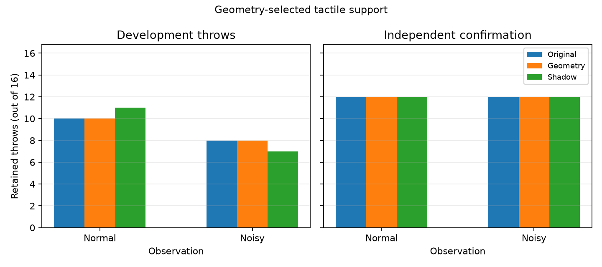

# Geometry-selected tactile support for cuboid catches

## Controller and simulation assumptions

This experimental rule starts from the original `SphereCageClosure`. After the close command it uses contact points, normals and force magnitudes from completed MuJoCo steps, plus robot fingertip positions, to choose a single unloaded candidate finger. Contact normals are force-weighted with a 2 N per-contact weight cap; when the weighted normal is too ambiguous, the rule does nothing. It uses a point 45 mm along the estimated inward normal as a heuristic opposite-side proxy, then selects the nearest unloaded fingertip within 140 mm. This proxy is **not** the true object center or a proven reachable contact location. The candidate is reconsidered at most every 40 ms.

From 20 to 240 ms after the close command, the selected finger receives a bounded closing bias unless already loaded or short-duration opposing normals are present. All currently loaded fingers immediately receive zero *additional* geometry-assist command; existing nominal commands can still move them. Bias is changed at at most 0.6 rad/s and tapers after the rule is inactive; switches or newly loaded fingers can remove the extra command immediately. The per-flexor extra actuator torque-equivalent command is clipped to 0.20 N m; this does not cap contact forces. The shadow variant executes the same observation and selection calculations but does not issue the extra commands.

Important limitation: although the new geometric selection does not read the true projectile center, the inherited nominal `ContactClosure` uses MuJoCo's true object center for its support test, and contact forces/positions and robot states are ideal simulated signals. The entire system is therefore **not tactile-only or hardware validated**. No machine learning is used.

## Development and independent confirmation

An initial development pilot at 90 mm selected no digit in its first two trials; inspection found candidate distances up to approximately 161 mm. The cutoff was changed to 140 mm and additional protection was added to immediately remove extra commands from a newly loaded finger. The pilot scripts/data predate the final loaded-finger masking and are archived only as development history; seed 1281 is consequently development data.

Development seeds 1281–1282 and fresh confirmation seeds 1291–1292 provide 32 different physical throws total. Each throw is tested under normal and noisy observations and original, shadow, and geometry methods: 192 full scoring simulations. The same launch is reused across profiles. Each policy separately prepares a scoped fixed-intercept fixture, retaining the existing wall-clock deadline; policy order rotates. Contact calculations and system scheduling can change deadline outcomes, so the shadow control matters.

Cells are `retained / retained and all seven-axis limits compliant`, out of 16 throws. Non-applied plans and unavailable fixtures remain in denominators.

| Batch | Observation | Original | Shadow | Geometry | Geometry retained gains / losses vs original |
|---|---|---:|---:|---:|---:|
| Development | Normal | 10 / 4 | 11 / 6 | 10 / 7 | 0 / 0 |
| Development | Noisy | 8 / 2 | 7 / 3 | 8 / 4 | 0 / 0 |
| Confirmation | Normal | 12 / 8 | 12 / 9 | 12 / 9 | 0 / 0 |
| Confirmation | Noisy | 12 / 9 | 12 / 9 | 12 / 9 | 0 / 0 |



The final geometry method delivered nonzero extra commands on 4, 9, 8 and 10 throws in these four rows respectively. Largest observed torque-equivalent change was 0.20000000000000018 N m (floating point tolerance). Shadow issued no extra command, yet in the development batch its hold result differed from original once in each profile, and in confirmation normal it matched the geometry count for full compliance. The geometry rule did not rescue a previously unretained throw versus original in any of the 64 launch/profile comparisons. Small differences in compliance cannot be confidently attributed to the action in this sample.

The counts reaching the existing stable-opposition diagnostic within 100 ms were 10/16, 7/16, 9/16 and 9/16 for each of original, shadow, and geometry respectively. This diagnostic can include the palm and uses simulated geometry; equal counts do not mean each force or trajectory was identical. The first 20 ms impulse and acceleration precede most of the added action, so their near-zero median paired differences in the retained subsets do not demonstrate impact cushioning. Nonlinear dynamics, contact, planner and measured deadline variations can change individual outcomes. The rule does not independently control arm acceleration, and physical retention does not guarantee seven-axis compliance.

## View and reproduce

The animation is a separate rerun of confirmation seed 1291 case 1 (both methods retained and were compliant). [Original](example_1291_1/original.gif) · [Geometry assist](example_1291_1/geometry.gif). Reruns are not guaranteed identical because actual deadlines remain active. To play the recorded frames:

```powershell
& 'D:\test code\.venv\Scripts\python.exe' -m experiments.view_cuboid_audit results/geometry_support/example_1291_1/geometry_replay.json.gz --speed 0.25 --loop
```

From the repository root:

```powershell
$env:OPENBLAS_NUM_THREADS='1'
python -m experiments.geometry_support_study --seed 1291 --profile normal --output-dir runs/geometry_1291
python -m experiments.geometry_support_replay --seed 1291 --case 1 --profile normal --output-dir runs/geometry_replay --render
```

Raw per-trial CSVs and `analysis/pairs.csv` retain all outcomes and impact/100 ms movement values; `analysis/summary.csv` aggregates them. Twenty-five project tests passed, including loaded-finger preservation, shadow no-op and limit checks. Both saved replays load in the current model.

## Next

Do not promote this heuristic to the default controller. Measure whether the selected fingertip actually approaches the target and makes useful sustained contact; distinguish no candidate, unreliable normal, already-opposed contact, and selected-but-no-contact cases. Investigate the separate arm acceleration failure and reduce reliance on simulator ground truth before making real-world claims. Evaluate any revised rule on new throws with the same paired shadow controls and complete scoring.
