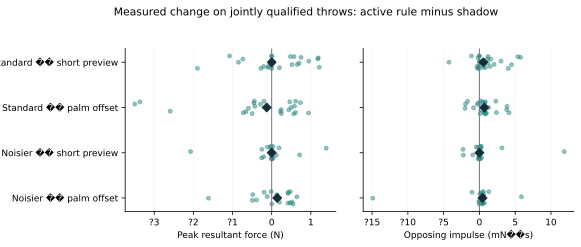

# 关节约束下的柔和接球

**当前推荐继续使用 `track_reserve_edge`。** 三轮共完成 1,200 次 MuJoCo 仿真，覆盖 168 个不同发射，每个发射均在两种观测条件下测试多种方法。正常和较差观测下，都能在部分抛球上保持接点、提高触球时的顺球速度，但实际增量很小，整体完整合规数没有上升。最后一轮基线的较差观测下，19 个抓稳但超限的球中，有 17 个在头 20 ms 就出现关节加速度超限。

## 比较目标与控制条件

球类基线为 `track_reserve_edge`。所有策略使用同样的 60 g 球、手掌几何、接触材料、延迟观测、滚动选点、闭指和制动控制。每个种子有 8 个长抛。两种观测分别为 2 mm 噪声、20 ms 延迟和 4 mm 噪声、40 ms 延迟。各策略用相同的发射状态与观测噪声，按种子和球号轮换运行顺序。每个条件的分母包括没有下发计划或没有抓稳的球。所有观测和结果均来自 MuJoCo。

抓稳需要主动计划已经下发、球未落地，首次接触经过 0.3 s 过渡后，持续两秒有手指接触且相对掌心漂移不超过 25 mm。完整合规还需要七个关节全程满足速度 ≤1 rad/s、加速度 ≤4 rad/s²、关节行程和执行器力矩限值。比较柔和度时，对同一个抛球计算策略减对照的差值，然后取中位数。最重要的是双方都完整合规的配对，另保留双方都抓稳的配对以核对结论。评价窗口均为从实际首次接触开始的 20 ms。峰值力是手对球的矢量合力峰值，反向冲量是在首次来球方向反向上积分的合力，负差代表对应指标降低。冲量的定义仅覆盖这个早期窗口。

## 借鉴的方法与实现

- Tassi 等的 IMA-Catcher 用接触前的速度匹配和方向反射质量优化接触。在现有七轴平台上，用预计接触姿态的掌心雅可比与质量矩阵，计算掌面法向冲量和七轴速度跳变的近似值。[论文，第 2.1、3.4.4 节](https://arxiv.org/html/2506.20801v1)
- Yan 等把接触位置和入射方向纳入撞击分析。我们把这个思想用于两个可行拦截方案之间的选择，并在后续实验中直接比较掌面上不同的接触位置。两项实现均使用本仓库自己的 MuJoCo 模型与控制代码。[论文，第 III–IV 节](https://www.honda-ri.de/pubs/pdf/5663.pdf)

规划器先照常对七个候选高度求解，检查位置与姿态误差、七轴状态、力矩、碰撞采样和制动行程。只有至少两个可行解、且距两个预计接点都不超过 0.55 s 时，才在原分数前两名里比较。可选的两种预测如下。

- `inertia` 使用法向相对速度和两物体的约化质量估计无反弹法向冲量。用七轴惯性子矩阵近似其他关节固定时的响应，把冲量均摊到 20 ms，再乘以关节对法向冲量的响应，叠加计划关节加速度。这是负载排序模型，不能证明实际关节加速度合规。
- `preview` 把已送达的球轨迹和候选机械臂轨迹放入独立的仿真状态。从预计到点前 24 ms 起推演，寻找手与球的首次接触，并记录随后 20 ms 的七轴加速度、峰值合力、反向冲量。预演使用名义逆动力学跟踪、最近的手指指令和接触后平滑制动，实际执行使用原来的低层反馈和闭指器。
- 两者都给规划周期预留 0.6 ms 收尾余量。预测不完整时返回第一名，整个规划超出 20 ms 时仍由原控制器丢弃该次新命令。重新排序允许预测峰值力增加最多 1%、冲量增加最多 2%。若第一名预计加速度已合规，第二名也须预计合规且峰值力至少下降约 2%。若第一名预计超限，第二名须预计合规或将加速度峰值降低超过 5%。这些百分比仅用于候选选择，最终合格线不变。

## 前两名重排

种子 1011–1013 的 24 球用于初步检查，预先固定的另 48 个发射（1021–1026）用于复核，两批都运行了全部三种策略。下表为后 48 球。次数指规划周期，每个球可多次提出并下发新拦截轨迹。峰值力和冲量变化取双方合规球的配对中位数。

| 观测 | 方法 | 抓稳 / 合规（各 48 球） | 完成比较 / 尝试 | 超时回退 | 第二名实际下发次数 | 双方合规球 | 峰值力差 N | 冲量差 N·s |
|---|---|---:|---:|---:|---:|---:|---:|---:|
| 正常 | baseline | 47 / 37 | — | — | 0 | — | — | — |
| 正常 | inertia | 47 / 40 | 743 / 755 | 12 | 0 | 37 | 0.000 | 0.00000 |
| 正常 | preview | 46 / 38 | 103 / 765 | 662 | 8 | 35 | 0.000 | 0.00000 |
| 较差 | baseline | 44 / 29 | — | — | 0 | — | — | — |
| 较差 | inertia | 44 / 32 | 693 / 726 | 33 | 0 | 29 | 0.000 | 0.00000 |
| 较差 | preview | 44 / 33 | 0 / 742 | 742 | 0 | 27 | 0.000 | 0.00000 |

快速惯性规则在这 48 球的两种观测下都没有真正下发过第二名。完整预演只在正常观测下下发 8 次，较差观测的 742 次尝试全部因预算回退。双方都合规的球上，力与冲量差的中位数均为零。真实运行耗时影响规划与低层命令的交付，即使最终选择相同也可能出现抓取结果差异，故不能把表中的合格数差异当作重排收益。

## 缩短接触预演、调整掌面落点

另取种子 1031–1036，每种观测 48 球。每种新策略都设有影子对照（`_shadow`），执行同一套候选计算，最终下发基线的候选。记录实际墙钟耗时，计算开销相近，两次运行的交付时刻仍可能不同。

- `short` 用几何检查定位预计首次接触，再用局部速度和偏置力矩推演前 20 ms。正常观测下完成 385/686 次比较，83 次下发第二名，涉及 28 球。较差观测下完成 57/685 次，20 次下发第二名，涉及 6 球。
- `spot` 在已有计划成功下发且距接点还有 0.18–0.55 s 时，比较掌心和八个距掌心 6 mm 的偏置，按预测的关节速度跳变筛选，要求估算冲量增加不超过 1%。它与基线原有的 16 mm 可达性补救分开记录。正常观测有 42/48 球实际用了新偏置，较差观测有 43/48 球用了新偏置。

各格分母均为 48。力和冲量使用本行策略减其影子对照，只计双方均合规的相同抛球。

| 观测 | 策略 | 抓稳 / 合规 | 影子抓稳 / 合规 | 双方合规球 | 峰值力差 N | 反向冲量差 mN·s |
|---|---|---:|---:|---:|---:|---:|
| 正常 | 原基线 | 41 / 30 | — | — | — | — |
| 正常 | 缩短预演 | 42 / 29 | 41 / 32 | 25 | 0.000 | +0.553 |
| 正常 | 掌面偏置 | 36 / 32 | 41 / 31 | 25 | −0.128 | +0.697 |
| 较差 | 原基线 | 43 / 26 | — | — | — | — |
| 较差 | 缩短预演 | 43 / 24 | 44 / 27 | 21 | 0.000 | 0.000 |
| 较差 | 掌面偏置 | 38 / 26 | 43 / 25 | 19 | +0.141 | +0.430 |

预演加速以后能实际换点，两种条件下完整合规数都比各自影子对照少 3。掌面偏置使正常观测的峰值力中位数略降，但两种条件的反向冲量均上升，两种条件都少抓稳 5 球。逐球散点中的菱形表示配对中位数，左侧代表物理指标降低。



## 固定接点，只调整顺球速度

种子 1041–1046，每种观测 48 球。用原计划的两段等时长关节加速度构造微调。设剩余时间为 T，七轴终端速度增量为 y，则第一段加速度减 y/T，第二段加速度加 3y/T。在同一个规划接触时刻，两段积分后七个关节的位置与原计划完全相同，终端速度改变 y。相同的关节终点保留相同的规划掌姿。物理触球时刻与位置仍受跟踪误差和实际碰撞影响。

优化目标是掌心沿预测来球方向额外增加 0.06 m/s。仅对原计划剩余时间不超过 0.65 s 的候选尝试，按保留速度余量、关节行程与加速度的可用区间求解。全量改动不可行时再尝试半量。新计划须至少有 0.008 m/s 的预测增益、保留触球后制动行程、通过两段关节位置极值检查及七个时刻的力矩和碰撞检查。每次提出时均校验终端位置和速度恒等式。实际下发后仍使用现有闭环跟踪器；事后逐步用原来的四项关节指标判分。

| 观测 | 基线抓稳 / 合规 | 只算不下发的影子抓稳 / 合规 | 微调抓稳 / 合规 | 实际下发的球 | 实际下发次数 | 每次下发平均预测速度增量 |
|---|---:|---:|---:|---:|---:|---:|
| 正常 | 41 / 33 | 41 / 35 | 41 / 33 | 19 / 48 | 100 | 11.48 mm/s |
| 较差 | 42 / 23 | 43 / 23 | 42 / 22 | 16 / 48 | 84 | 10.60 mm/s |

下表为微调减影子的逐球差值中位数。顺球速度取首次接触时掌心速度在实际来球方向上的投影（`measured_fraction × contact_ball_speed`）。第一张表的预测值按下发次数统计，下表的实测值按抛球统计。

| 观测 | 配对筛选 | 球数 | 实测顺球速度差 mm/s | 峰值力差 N | 反向冲量差 mN·s |
|---|---|---:|---:|---:|---:|
| 正常 | 双方均抓稳 | 40 | 0 | 0 | 0 |
| 较差 | 双方均抓稳 | 42 | 0 | 0 | 0 |
| 正常 | 双方均合规 | 32 | 0 | 0 | 0 |
| 较差 | 双方均合规 | 21 | 0 | 0 | 0 |
| 正常 | 双方均合规且微调实际下发过 | 10 | +0.64 | −0.063 | −0.045 |
| 较差 | 双方均合规且微调实际下发过 | 8 | +3.30 | −0.021 | −0.165 |

最后两行是执行过微调的小样本。正常与较差观测下分别有 7/10 和 7/8 球实测顺球速度提高。它们的峰值力和反向冲量差的中位数都略降，但在两种方法均合规的完整配对中，三项中位数都为零。直接与原基线比较时，正常条件新增 2 个合规、原本合规的丢了 2 个；较差条件新增 2 个、丢了 3 个。当前版本继续用原基线做默认演示。

## 哪些失败值得继续查

最后一轮基线下，正常观测 41 个抓稳球里有 8 个超限，其中 6 个在触球后 20 ms 内出现加速度超限。较差观测 42 个抓稳球里有 19 个超限，其中 17 个在这段时间出现加速度超限。这 8 个和 19 个球都通过了位置、速度和执行器力矩检查。较差观测下，17 个早期加速度超限球的峰值接触合力中位数为 30.06 N，23 个完整合规球为 30.94 N。在这批球上，仅以合力大小排序不足以解释哪些关节会超限。

下一项最有针对性的实验是回放这些球，每 2 ms 记录七轴各自的加速度、先触球的手部部位及当时的关节姿态。若峰值集中在固定轴或接触部位，再用同一批发射去比较可行姿态或法向响应；目前数据只定位到时间窗口，尚未确定是哪一个关节。仿真力与冲量依赖当前接触模型，所有数值仅适用于本模型与观测设置。

## 数据与复现

| 实验 | 种子 | 逐球数据 | GitHub Actions |
|---|---|---|---|
| 两个可行方案重排 | 1011–1013、1021–1026 | [432 行](shortlist_trials.csv) | [18 个作业](https://github.com/Diara0430/MEAM5170-Final-Project/actions/runs/45784490073) |
| 短预演与掌面偏置 | 1031–1036 | [480 行](local_trials.csv) | [12 个作业](https://github.com/Diara0430/MEAM5170-Final-Project/actions/runs/45785220142) |
| 固定接点微调速度 | 1041–1046 | [288 行](trim_trials.csv) | [12 个作业](https://github.com/Diara0430/MEAM5170-Final-Project/actions/runs/45786074508) |

安装仓库的 `scene_setup/requirements.txt` 后，可在仓库根目录重跑单个种子。每个命令都会在指定目录输出 `trials.csv`。批量工作流将 BLAS 线程数设为 1，以减少实时控制循环的计时波动。

```bash
python -m experiments.intercept_impact --seed 1021 --profile normal --output-dir results_local/shortlist
python -m experiments.local_impact --seed 1031 --profile noisy --output-dir results_local/local_impact
python -m experiments.fixed_point_trim --seed 1041 --profile normal --output-dir results_local/trim
python -m experiments.plot_intercept_impact results/intercept_impact
```

后续已完成七轴逐步回放、第六轴针对性验证及自旋长方体的完整接取实验。[查看结果、逐球数据和长方体回放](../shape_transfer/README.md)。
