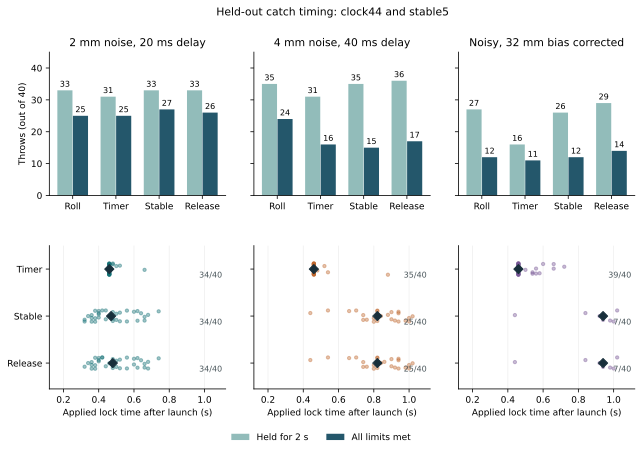
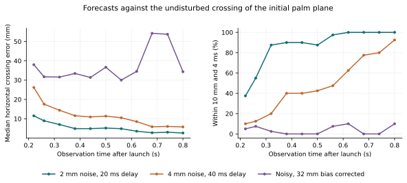

# 长抛接球中何时锁定拦截点

**实验结论**　在三批共 96 个独立长抛中，正常观测时五帧稳定后锁点与持续滚动的完整通过数为 59 和 58。高噪声时为 41 和 54。当前默认继续滚动选点，需要固定目标时可选“五帧稳定且预计还剩至少 350 ms”。这个阈值只在额外的 24 球上检验过。详细数据见下文。

这里的“锁定”指固定世界坐标系中的三维目标和到达该目标的绝对时间。实验也固定该交点对应的来球速度参考。锁定后仍然从实测机械臂状态规划关节轨迹并跟踪，保留原有 30% 软速度目标、接触预测、平滑制动与限时力矩修正。各策略从第一份可行方案实际下发起均可移动手臂。此实验没有上一轮固定端点速度扫描的 100 ms 准备等待。

## 在线规则

每 20 ms 接收一帧有噪声和传输延迟的球心位置。控制器仅使用已送达观测拟合的重力弹道。每次滚动规划先沿七个高度选出可行接点，控制器再决定是否锁住该点。新参考在下一规划周期实际下发时才完成锁定，超时或尚未送达的提案无法触发锁定。

| 规则 | 何时提出锁定 |
|---|---|
| rolling | 始终重新评估可行接点 |
| clock26 / clock44 / clock62 | 从抛出后 0.26 / 0.44 / 0.62 秒起，尝试锁住可行目标 |
| lead35 | 当前估计距离候选接点不超过 0.35 秒 |
| stable4 | 最近连续 4 帧在当前候选高度预测的交点，两两水平距离最多 10 mm，预计到达时间极差最多 4 ms |
| stable5 | 最近连续 5 帧在同一候选高度的水平距离最多 6 mm、时间极差最多 2 ms。五帧跨越 80 ms |
| confidence4 | 满足 stable4，并且拟合残差与预测距离给出的水平误差半径不超过 12 mm、时间半宽不超过 4 ms |

最后一条使用拟合残差估计精度。持续的系统偏差也可能产生小残差，因此这些宽度仅作为决策指标。七个候选高度可能交替被选中。上述 `stable` 系列用同一高度重算各帧的球轨迹预测，末节额外检验机械臂先前接到的目标是否也应一致。

## 开发组选择

种子 931–933，每个种子八球。正常观测为 2 mm 高斯噪声、20 ms 延迟，高噪声观测为 4 mm、40 ms。两种条件均使用相同的 24 个发射状态。表内为全程合规且主动保持了两秒的球数。

| 策略 | 正常 /24 | 高噪声 /24 |
|---|---:|---:|
| rolling | 14 | 13 |
| clock26 | 12 | 10 |
| clock44 | 14 | 13 |
| clock62 | 12 | 9 |
| lead35 | 16 | 11 |
| stable4 | 12 | 8 |
| stable5 | 15 | 11 |
| confidence4 | 16 | 10 |

在定时类和预测稳定类中分别选择一条规则。先比较两种条件合计完整通过数，再比较两条件中较低的完整通过数、总保持数，最后按预定顺序破同分。由此固定 `clock44` 和 `stable5` 进入独立复核。另测试 `stable5_release`：锁定后若连续两帧的水平预测偏移超过 20 mm 或到达时间偏差超过 6 ms，并且离原目标时间至少还有 160 ms，重新启动滚动选点。每球最多撤销一次。日志分别记录撤销决定以及不同新目标实际下发的时间。

## 独立复核

种子 941–945，共 40 个新球，各策略在同一球上配对，执行顺序随球号轮转。第三种条件在高噪声基础上加入 32 mm 水平观测偏差，于抛出后 0.46–0.60 秒之间的一帧开始纠正。偏差方向和纠正时刻按发射编号固定，控制器没有收到该事件标签。球的真实飞行没有受外力扰动。

“抓稳”要求至少一份主动运动计划已下发，触球后留 0.3 秒过渡，再保持 2 秒，期间手指持续接触，球未落地，相对掌心漂移不超过 25 mm。“完整通过”还要求全程实测七关节速度不超过 1 rad/s、加速度不超过 4 rad/s²、关节位置与执行器力矩均在限值内。同一行的分母均为 40，未执行计划或未抓稳均保留在分母中。后三列仅对实际锁定球取中位数，这三组里所有锁定球都有首次触球和后续预测记录。

| 观测 | 在线策略 | 抓稳 | 完整通过 | 实际锁定 | 锁定时刻 s | 锁定至首次触球 s | 触球前末次预测与原锁点的水平距离 mm |
|---|---|---:|---:|---:|---:|---:|---:|
| 正常 | rolling | 33 | 25 | 0 | — | — | — |
| 正常 | clock44 | 31 | 25 | 34 | 0.46 | 0.577 | 4.7 |
| 正常 | stable5 | 33 | 27 | 34 | 0.47 | 0.581 | 5.4 |
| 正常 | stable5_release | 33 | 26 | 34 | 0.48 | 0.543 | 5.3 |
| 高噪声 | rolling | 35 | 24 | 0 | — | — | — |
| 高噪声 | clock44 | 31 | 16 | 35 | 0.46 | 0.576 | 10.4 |
| 高噪声 | stable5 | 35 | 15 | 25 | 0.82 | 0.200 | 6.4 |
| 高噪声 | stable5_release | 36 | 17 | 25 | 0.82 | 0.200 | 6.4 |
| 偏差中途纠正 | rolling | 27 | 12 | 0 | — | — | — |
| 偏差中途纠正 | clock44 | 16 | 11 | 39 | 0.46 | 0.536 | 32.0 |
| 偏差中途纠正 | stable5 | 26 | 12 | 7 | 0.94 | 0.136 | 9.8 |
| 偏差中途纠正 | stable5_release | 29 | 14 | 7 | 0.94 | 0.136 | 9.8 |



正常观测下，`stable5` 与滚动选点抓稳的是同样 33 球。在关节和执行器限值也满足的指标上，5 球从失败变为通过，3 球从通过变为失败，净增 2 球。独立追加的 32 球上分别得到 19 和 18 个完整通过，小幅优势没有给出唯一最佳时刻。

高噪声下，`stable5` 和滚动策略都抓稳了 35 球，逐球组成有一进一出。完整通过则有 9 球从通过变为失败，反向为 0。这 9 球中 8 球仍抓稳，但首次触球后 20 ms 内出现超过 4 rad/s² 的关节加速度，另 1 球没有抓稳。8 个加速度超限案例里有 1 球实际没有锁定。实验按运行中的真实求解耗时丢弃逾期指令，故策略间的差异包含运行时抖动，不能全部归因为冻结接点。其余 7 个加速度案例都在抛出后 0.74–0.98 秒才锁定。

偏差纠正条件下，0.44 秒定时规则实际锁了 39 球，后续预测相对锁点的最大水平偏移逐球中位数为 93.5 mm。定时策略抓稳 16 球，滚动选点为 27 球。允许撤销的稳定规则抓稳 29 球、有 14 球完整通过，其中 2 球实际撤销并成功下发不同的新目标。触发次数太少，难以据此把撤销阈值定为通用参数。逐球核对，种子 943 的第 2 号球在 0.44 秒锁定，0.58 秒撤销，0.60 秒下发新目标，成功从脱手变为抓稳，但仍有关节超限。第 3 号球换点后仍未抓稳。组内多出的两个完整通过都来自其他球。正常与高噪声各只发生一次实际重新选点。

## 球的预测何时变准

使用相同的 40 个发射状态和观测噪声序列，关闭球与环境的碰撞，用未受手掌干扰的下降段穿过初始掌心高度的真实交点作为基准。每一帧只使用当时已送达的观测。评价同一水平面便于比较随观察时间变化的误差，在线抓取另外允许机械臂选七个高度。每格为“水平误差中位数 mm / 同时满足水平误差 ≤10 mm、到达时间误差 ≤4 ms 的球数”，每种条件共 40 球。

| 抛出后时间 | 正常 | 高噪声 | 偏差中途纠正 |
|---|---:|---:|---:|
| 0.26 s | 8.9 / 22 | 17.6 / 5 | 31.7 / 3 |
| 0.44 s | 4.9 / 36 | 10.9 / 16 | 31.4 / 0 |
| 0.62 s | 3.6 / 40 | 8.5 / 25 | 34.5 / 4 |
| 0.74 s | 3.0 / 40 | 6.0 / 32 | 53.8 / 0 |
| 0.80 s | 2.6 / 40 | 5.8 / 37 | 34.3 / 4 |



在预计还剩至少 120 ms 时，单看球轨迹，五帧稳定条件首次满足的准确数 / 触发数为正常 37/40、高噪声 26/30、偏差纠正 10/14，三组均从 40 球起算。四帧加拟合不确定度筛选分别为 39/40、32/34、13/15。偏差纠正初期，16 帧滚动窗口同时包含新旧观测，拟合速度也会受位置偏移影响。这与 0.74 秒时出现的较大外推误差相符。因此“多看几帧”仍需结合测量是否有系统性变化以及机械臂剩余反应时间。

## 是否要等机械臂连续选中同一个点

额外使用种子 951–954 的 32 个新球。`confirmed` 在五帧预测稳定后，进一步要求过去两个相邻周期实际下发的目标和本次提出的目标三者的三维最大距离不超过 10 mm、拦截时间极差不超过 4 ms。每个条件独立比较同一批球。

| 策略 | 正常抓稳 / 完整通过 | 正常锁定数 | 高噪声抓稳 / 完整通过 | 高噪声锁定数 |
|---|---:|---:|---:|---:|
| rolling | 22 / 18 | 0 | 28 / 19 | 0 |
| clock44 | 24 / 19 | 27 | 27 / 18 | 29 |
| stable5 | 24 / 19 | 27 | 27 / 15 | 18 |
| confirmed | 25 / 20 | 27 | 25 / 17 | 15 |

在这组球上，增加机械臂目标一致性检查比五帧稳定多通过 1 个正常球、2 个高噪声球，但高噪声抓稳数同时少了 2 个。滚动选点在高噪声下仍以 19/32 的完整通过数领先。

相同 32 球、相同参数另跑一遍，正常观测下滚动、定时、五帧稳定、再加机械臂目标一致性四条规则的完整通过数依次为 18、21、21、19，高噪声下为 19、13、15、15。高噪声下滚动选点两次都领先，而额外要求机械臂目标一致的细小差异在复跑时没有保持。两次运行沿用实际计时和超时回退，逐球结果均已归档。

## 给锁点留出 350 ms 是否更好

最后在种子 961–963 的 24 个新球上测试 `early_stable`。它沿用五帧稳定条件，并只在“预计接点时刻 − 计划预计实际下发时刻 ≥ 0.35 s”时尝试锁定。下发有一个 20 ms 周期的延迟。未达到门槛时仍执行原有滚动规划。0.35 秒是本轮检验的一个候选值，其数值沿用开发组剩余时间规则的时间尺度。这里考察的是至少保留这段时间，与开发阶段 `lead35` 的不等号方向相反。三种策略均无法读取传感器条件标签来作锁点决策。

每格为“抓稳 / 完整通过 / 实际锁定”，每种条件每条策略 24 球。

| 策略 | 正常 | 高噪声 | 偏差中途纠正 |
|---|---:|---:|---:|
| rolling | 19 / 15 / 0 | 20 / 11 / 0 | 15 / 8 / 0 |
| stable5 | 19 / 13 / 21 | 20 / 11 / 14 | 16 / 7 / 4 |
| early_stable | 19 / 14 / 19 | 20 / 12 / 4 | 15 / 8 / 1 |

高噪声下，这个条件把实际锁点从 14 球降到 4 球。锁点至首次触球的时间中位数从 0.228 秒变为 0.386 秒，后者只代表 4 个实际锁定球。三种观测条件各比单用五帧稳定多 1 个完整通过。与持续滚动配对比较，正常少 1 球、高噪声多 1 球、偏差纠正打平。三种条件汇总后，两者均为 34/72，分母为 24 个发射状态在三种条件下的配对运行。现阶段保留这个选项供对照，不能用这次结果把 350 ms 定成最快或最优的阈值。

把三个互不重叠的新球组各计一次（每种观测有 40 + 32 + 24 = 96 个不同球，不重复计入复跑），正常观测下滚动 / 五帧稳定完整通过 58 / 59 球，高噪声下为 54 / 41 球。因此以稳定接球且满足关节约束为首要目标时，默认继续滚动选点。需要在演示中展示固定接点时，用五帧稳定加剩余时间门槛，在门槛通过前照常驱动手臂。上述判断限于这套 MuJoCo 长抛分布、控制器和传感器模型，尚无实机接球结果。

## 数据和复现

- [开发组全部 384 次](development.csv)、[独立复核全部 480 次](validation.csv)、[实际目标一致性对照 256 次](confirmed_targets.csv)、[同组复跑 256 次](confirmed_repeat.csv)、[最小剩余时间对照 216 次](minimum_lead.csv)。
- [各帧预测误差](forecast_by_time.csv)、[每球每条规则首次触发时的误差](forecast_at_first_gate.csv)。动作、限值、求解耗时和锁点撤销记录均在对应在线实验 CSV。未触发的门槛不出现在首次触发表中，准确率若只对触发球计算，需要同时报告覆盖了多少球。
- GitHub Actions 留有完整运行日志和原始文件。[开发和独立复核](https://github.com/Diara0430/MEAM5170-Final-Project/actions/runs/45767752885) · [无接触飞行](https://github.com/Diara0430/MEAM5170-Final-Project/actions/runs/45768393991) · [机械臂目标一致性](https://github.com/Diara0430/MEAM5170-Final-Project/actions/runs/45768322183) · [相同种子复跑](https://github.com/Diara0430/MEAM5170-Final-Project/actions/runs/45769015457) · [最小剩余时间](https://github.com/Diara0430/MEAM5170-Final-Project/actions/runs/45769015514)。
- 在仓库根目录、Python 3.12 环境下运行以下命令。Actions 将 OpenBLAS 与 OpenMP 线程数设为 1。模拟以物理时钟推进，指令丢弃使用实际运行耗时，不同 CPU 负载可能改变临界案例。

```sh
python -m pip install -r scene_setup/requirements.txt
python -m unittest experiments.test_lock_timing experiments.test_ball_observer
python -m experiments.lock_timing --seed 941 --profile normal --selection results/lock_timing/development.csv --output-dir local/lock-941
python -m experiments.lock_forecast_error --profile normal --output-dir local/forecast
python -m experiments.settled_intercept --seed 951 --profile normal --output-dir local/confirmed
python -m experiments.settled_intercept --seed 961 --profile noisy --lead-study --output-dir local/lead
python -m experiments.plot_lock_timing results/lock_timing
```
