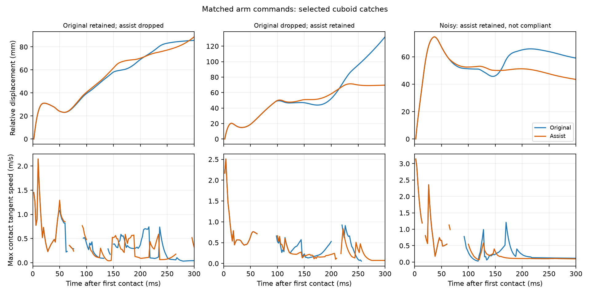

# Contact-point analysis with matched arm commands

## Purpose and experimental control

This diagnostic follows up three deliberately selected previously divergent cuboid throws: 1271 case 4 normal (assist previously lost), 1272 case 7 normal (assist previously rescued), and 1272 case 3 noisy (assist previously rescued physically but not fully compliant). They are selected examples, not a random sample and not a success-rate estimate.

For each throw, the **original** controller runs first. Its seven arm-actuator position commands are recorded at each 2 ms step, and its high-level MPC deadline decisions are saved. In the shadow and assist reruns, those recorded arm commands are written from the start until the original run's first-contact time plus 300 ms; recorded MPC deadline decisions are replayed where available. Actual hand, object and arm states can still respond differently to contact. After the cutoff, each run resumes its own arm command computation. The recorded schedule may not cover runs that last longer; such extensions are logged and would use measured timing. In these three cases there were no missing arm commands, no recorded deadline decision mismatches, and no schedule extensions. This is a diagnostic open-loop replay condition, not the normal closed-loop policy or a complete-horizon causal isolation.

The shadow policy calculates the assist but does not change hand controls. For all three cases, recorded relative object position, all 16 hand joint positions and hand target commands were identical to the original at every shared frame through 300 ms. The assist and original were also identical in these recorded quantities through the first 20 ms. Every saved shadow/assist arm command in the synchronized interval was checked against the original (657, 707 and 728 steps respectively). `analysis` verifies those properties directly from the CSVs. This does not imply equality of joint torques or post-contact state trajectories.

## Results

| Selected case | Original: held / fully compliant | Assist: held / fully compliant | Original / assist peak seven-axis acceleration, entire run |
|---|---:|---:|---:|
| 1271 / 4, normal | 1 / 1 | 0 / 0 | 3.74 / 5.22 rad/s² |
| 1272 / 7, normal | 0 / 0 | 1 / 0 | 3.78 / 7.45 rad/s² |
| 1272 / 3, noisy | 0 / 0 | 1 / 0 | 5.89 / 5.89 rad/s² |

The 4 rad/s² limit applies over the whole run. The assist recovered physical retention in the latter two examples, but neither recovered trial passed all seven-axis constraints. In the first example, it lost a previously retained and compliant catch. The post-cutoff arm controller can differ and can contribute to the final two-second outcome; these observations do not prove that the hand action alone caused the final result.

None of the nine trials reached the existing definition of 6 ms stable opposed support in the **first 100 ms**. Original still retained 1271/4, and assist retained the other two cases, so this indicator alone neither explains nor guarantees the outcome.



## Contact-point metrics and limitations

`contacts.csv` contains each mapped hand-object contact with at least 0.02 N modeled normal force during the first 300 ms. At each contact point, MuJoCo body Jacobians and the recorded generalized velocity give object-point minus hand-point velocity. Its component normal to the contact and the norm of its tangent component are recorded, together with contact position, hand geometry, force and an approximate friction utilization. `frames.csv` contains the largest tangent speed among loaded contacts per step, summed normal forces, object relative position, and hand joint positions, velocities and targets.

For the 20–100 ms interval, the median of the **per-step maximum** tangent speed (only steps with qualifying contacts) was approximately 0.450 vs 0.481 m/s in 1271/4 and 0.563 vs 0.564 m/s in 1272/7 (original vs assist). These conditional, selected-case values do not show a consistent reduction. A nonzero instantaneous tangent speed can involve contact switching, rolling, numerical dynamics and point motion; it is not by itself proof of sustained slip at one material point. Contact forces and friction are simulation outputs sensitive to geometry, timestep and contact model; force sums are not net force or hardware measurements.

## View and reproduce

Selected matched-arm rerun of 1272/7: [original GIF](1272_7_normal_final/original.gif) and [assist GIF](1272_7_normal_final/assist.gif). These are saved simulated trajectories (not the earlier benchmark rollout). Nine compact replay files cover all three methods and cases. From the repository root, for example:

```powershell
& 'D:\test code\.venv\Scripts\python.exe' -m experiments.view_cuboid_audit results/matched_support_contact/1272_7_normal_final/assist_replay.json.gz --speed 0.25 --loop
```

Rerun one case (real wall-clock decisions can differ):

```powershell
$env:OPENBLAS_NUM_THREADS='1'
python -m experiments.matched_support_contact_audit --seed 1272 --case 7 --profile normal --output-dir runs/matched_support_1272_7
python -m experiments.analyze_matched_support runs/matched_support_1272_7 --output runs/matched_support_summary.csv
```

Each case includes contact-point and frame CSVs, arm setpoints, recorded MPC deadline decisions and outcomes; the root `summary.csv` reports all cases. The recording/instrumentation uses temporary process-global patches and is intended for single-process diagnostics only. A synthetic physical-velocity test verifies the tangent/normal Jacobian decomposition, and all 24 project tests passed.

## Next

Use contact locations and forces to design a pre-specified geometry-aware hand action that avoids indiscriminate yielding of a loaded finger, while separately preserving a safe arm acceleration response. Evaluate it on independent throws with shadow controls and both retained and retained-plus-compliant metrics. The present three cases do not establish a general controller improvement. No machine learning is used.
