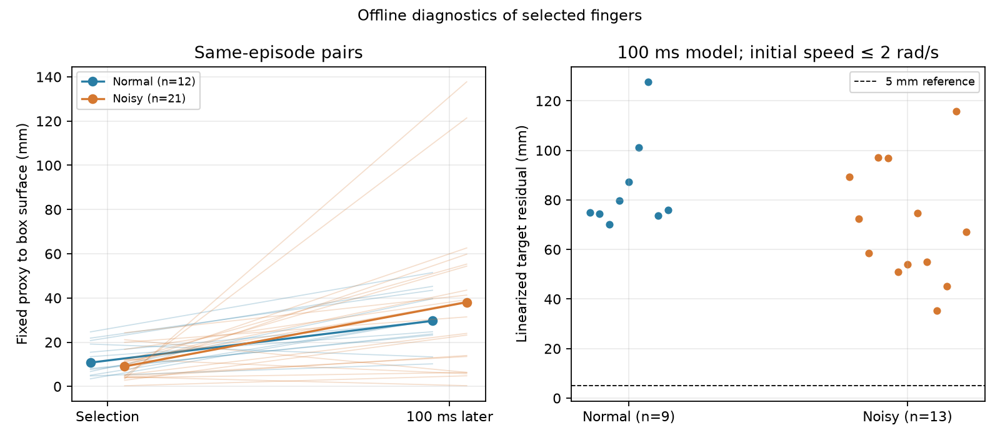

# Moving cuboid surface and local finger reach diagnostic

## What is measured

This offline audit records newly sampled cuboid launches (seeds 1301 and 1302, eight cases each) under normal and noisy observations. Each launch/profile is run with shadow and geometry methods: 16 different physical launches, 32 launch/profile combinations and 64 full scoring runs. The same physical launches are reused across observation conditions. The controllers and original deadline behavior are unchanged; recording adds overhead and may change delivered commands or outcomes. This is a diagnostic sample, not a statistically independent observation for every selection episode.

At each selected-finger episode, the recorder saves the controller's selection-time heuristic proxy, fingertip-body origin, finger joint state, joint limits and translational Jacobian. Separately it saves the actual MuJoCo box pose for offline evaluation. The controller **does not receive** this diagnostic box pose or the calculated surface distance. Its inherited nominal support detector still uses simulator object-center ground truth, as documented in the earlier study; the whole system is not tactile-only or hardware validated.

The scene's collision object is an aligned box with half sizes (32, 21, 17) mm. The recorder rejects a changed shape, size or body-to-geom transform rather than silently using the wrong surface. `analyze_moving_surface.py` uses the analytic signed distance to the oriented box: negative inside, positive outside, and absolute value for nearest-surface distance. Future measurements compare the **same world-fixed proxy** against the actual object trajectory 50 or 100 ms after the first saved post-step frame (roughly 52 or 102 ms after the pre-step selection). This is retrospective geometry, not a prediction. The actual rule reevaluates its live proxy at up to 40 ms intervals; it does not necessarily command the original proxy for 100 ms. Later hand/arm dynamics and controller decisions can affect the real trajectory.

## Fixed proxy versus moving surface

For geometry-assist episodes with a complete 100 ms future frame:

| Observation | Episodes with both timestamps | Median absolute proxy-to-surface distance at selection | Median 100 ms later | Median paired change |
|---|---:|---:|---:|---:|
| Normal | 12 of 13 | 10.79 mm | 29.65 mm | +18.85 mm |
| Noisy | 21 of 23 | 9.07 mm | 38.09 mm | +20.44 mm |

Episode samples can repeat within a throw and are not independent. The surface nearest to a point may switch between faces, and some proxy points are inside the box; absolute distances do not specify direction. This observation shows a static selection-time proxy may become stale in these episodes. It does **not** establish the accuracy of the controller's later reevaluated target or prove that a continuously tracked surface would improve capture.

## Local finger motion surrogate

For each selection, we solve an offline bounded linear least-squares problem for that digit's four joints:

`min || J Δq - (proxy - tip) ||`, subject to the model's joint-position limits and `|Δq_i| ≤ (2 rad/s) × 0.1 s`.

The arm is frozen and the tip-body origin—not the closest contact surface—is linearized at the recorded state. The 2 rad/s limit and 100 ms horizon are **analysis assumptions**, not verified LEAP actuator specifications. We ignore acceleration, torque, contacts, self-collision, coupling, object motion and arm motion; the allowed joint displacement assumes velocity can change instantly. Linearization is only local, so residuals are not a rigorous global lower bound or a safety/feasibility certificate. In particular, a large residual does not prove that the actual moving arm and hand cannot catch the object.

At selection, measured initial finger-joint speed already exceeded the 2 rad/s assumption in 4/13 normal and 10/23 noisy geometry episodes. Excluding those episodes, the remaining 9 normal and 13 noisy episodes all had more than 5 mm residual in this specific local model (median 76.03 mm and 67.11 mm respectively). The 5 mm threshold is a diagnostic reference, not a project safety limit. The target itself is a heuristic point, not a confirmed desirable object surface contact. Thus these numbers justify investigating prediction and reach-aware selection; they do not justify rejecting a catch in the real controller.



The shadow method uses the same observations and computations but does not apply extra finger commands. Results for both methods, signed/absolute distances, 50/100 ms availability, initial velocities and optimizer status are in `analysis/episodes.csv` and `analysis/summary.csv`. Geometry episodes that actually loaded the selected digit while it remained selected were 0/13 normal and 4/23 noisy. This is a different time window from the earlier follow-up-contact audit and must not be compared directly to its 50 ms follow-up counts.

## Reproduce

From the repository root:

```powershell
$env:OPENBLAS_NUM_THREADS='1'
python -m experiments.moving_surface_trace --seed 1301 --profile normal --output-dir runs/moving_normal_1301
python -m experiments.analyze_moving_surface --runs runs/moving_normal_1301 --output-dir runs/moving_analysis
```

Pass `--horizon-ms` and `--speed-rad-s` to change the assumptions; these values are recorded in each output row. Raw per-step state and original outcomes are in the four seed/profile directories. Analytic oriented-box distance, rotation, bounded linear solve and inconsistent joint-range behavior have focused tests. Thirty tests passed for the project. No machine learning is used.

## Next

Evaluate a causal prediction of the moving box surface using only delivered noisy observations, and include planned arm movement when assessing a digit's future approach. First validate prediction error and nonlinear reachable paths against fresh held-out launches, then test any controller change with original and shadow controls and both retention and joint-limit metrics. Do not use the diagnostic simulator ground truth as a controller input or add a hard failure rule based solely on this first-order estimate.
