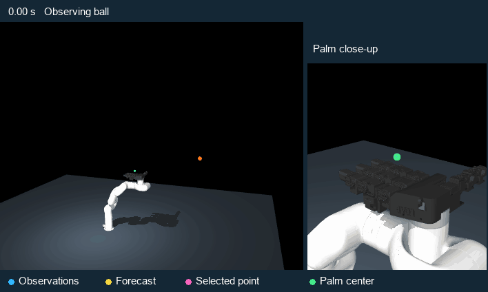

# 长抛接球的观察、预测和主动选点



回放使用种子 821 的第 0 球，以半速播放。蓝点是控制器已收到的位置观测，黄点是当时预测的后续轨迹，粉点是当前已下发计划的接点，绿点是仿真测得的掌心捕获中心。左右画面共用同一时钟。首次预测在 0.160 秒，首条手臂计划在 0.180 秒生效，首次触球在 1.032 秒。此球在触球前的最大掌心位移为 49.8 mm，保持了两秒，触球时的关节加速度峰值为 20.6 rad/s²。

## 实验设置

- 三个种子（821、822、823）各抛 8 球。飞至初始掌心高度的实际设定时间为 0.902–1.177 秒，水平跨度为 0.695–1.127 m。每个种子都包括两个飞行时间区间和两个侧向目标偏移区间。发射位置和初速仅用于初始化物理仿真。
- 模拟传感器每 20 ms 采一次球心的三维位置。各轴加入 2 mm 标准差的独立高斯噪声，测量延迟 20 ms。收到 8 帧后按已知重力拟合位置与速度，随后最多保留最近 16 帧。各策略对同一抛球使用相同的测量噪声序列。这里尚未接入 RGB 或 RGB-D 相机。
- 机械臂用预测的下降段与若干高度面的交点作为候选。高度相对初始掌心固定，七个候选均布在 ±65 mm 之间，三维坐标和到达时刻随每次新观测更新。每个候选需通过关节范围、速度、规划加速度、执行器力矩、碰撞采样、终端运动学误差及制动行程检查。可行解按终端位置、速度、姿态、控制量和耗时评分。20 ms 预算内交付的解在下一控制周期生效，超时继续执行已有参考。
- 各主动模式使用同一手指预成形策略、触觉闭指、30% 的速度匹配目标和接触后制动器。首次触球前，一步动力学预测器中移走了模拟球，以避免它提前预知碰撞。接触后仍使用仿真模型的接触状态和力反馈。

## 同一批 24 球的四种接法

| 接法 | 下发主动计划 | 碰到手 | 物理上保持两秒 | 按该策略完成保持 | 满足全部关节和抓持判据 |
| --- | ---: | ---: | ---: | ---: | ---: |
| 原地等球 | — | 23 | 4 | 4 | 0 |
| 固定初始掌心高度 | 12 | 24 | 16 | 12 | 0 |
| 沿轨迹比较 3 个高度 | 20 | 24 | 20 | 20 | 0 |
| 沿轨迹比较 7 个高度 | 22 | 24 | 22 | 22 | 0 |

物理保持要求未落地，首次触球 0.3 秒后连续两秒有手指接触，且球相对手掌的漂移不超过 25 mm。主动模式的策略成功还要求至少一条机械臂计划实际生效。固定高度组有 4 球在没有可执行移动计划时仍碰巧留在了手里。完整判据另外要求实测关节速度 ≤1 rad/s、加速度 ≤4 rad/s²、关节位置和致动器力矩合规。

- 首次预测向前推 200 ms、400 ms 时，三维位置误差的中位数分别为 7.5 mm 和 12.3 mm，分别用相应未来时刻首次接触前的实际球心核对。
- 七高度组有 21/24 球至少一次同时有两个可行候选。实际首选高度分布为 −43、−22、0、+22、+43、+65 mm，另外 2 球没有下发计划。1075 次 MPC 调用中有 44 次超过 20 ms，各次实际计时已影响控制决策。
- 22 个主动保持的球中，触球前掌心相对初始位置的最大位移中位数为 87.6 mm。首次触球步结束时，掌心距当时选定接点的中位数为 6.6 mm。计划到点与首次接触是两个不同的时刻。
- 22 球的最大关节加速度全部出现在首次触球后 20 ms 内，中位数为 22.0 rad/s²，其中 1 球也越过关节速度上限。触球时来球速度中位数为 5.31 m/s，掌心沿来球方向的实际速度分量约为球速的 6.4%。仅提高期望速度比例无法保证机械臂在接触时达到它。

## 到 12 月 1 日的 30 小时建议分配

| 工时 | 工作 | 核对指标 |
| ---: | --- | --- |
| 10 h | 结合实测掌心速度、预计法向相对速度及关节余量提前安排顺球运动，比较几种可实现的接触速度 | 记录实测速度匹配率、首次触球后 20 ms 的加速度和冲量，同时保留两秒保持率 |
| 7 h | 在触球前进入可调阻抗或柔顺控制阶段，协调合指和制动时机 | 同批球逐项比较，筛掉改变摩擦系数或放宽约束才能成立的结果 |
| 5 h | 用预测误差和求解耗时筛选候选点，检查两球没有可行计划的原因 | 可执行计划数、超时数和选点误差 |
| 5 h | 使用新种子，加入测量延迟变化、噪声和掉帧 | 按长短、偏移及观测条件分别报告物理保持和完整通过率 |
| 3 h | 导出演示、失败实例、对照表以及提交复现说明 | 从干净目录复现一球，并核对图表和逐球记录 |

## 复现

从本分支仓库根目录执行。每次运行用该机器的实际 MPC 求解时间处理超时，因此重复运行可能产生不同的计划。

```sh
python -m pip install -r scene_setup/requirements.txt
python -m unittest experiments.test_ball_observer
python -m experiments.observed_long_arc --seed 821 --output-dir results_local/arc821
python -m experiments.render_observed_arc results/observed_long_arc/example.json.gz replay.gif
```

逐球数据见 [trials.csv](trials.csv)。[本轮仿真和各种子的回放文件](https://github.com/Diara0430/MEAM5170-Final-Project/actions/runs/45753437245)对应提交 `54571ff2d`。三个种子用于这次开发比较，留出的新种子可用于后续检验。
