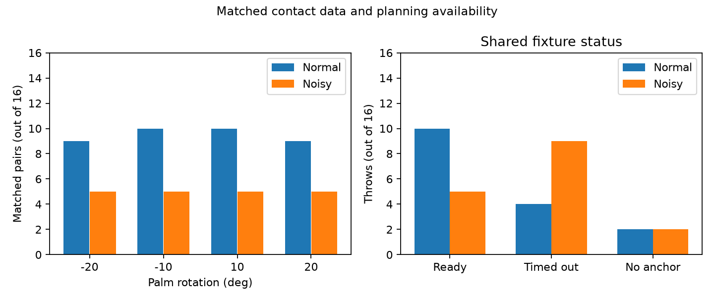

# Paired contact analysis under fixed observed intercepts

## Design

Seeds 1191 and 1192 each provide eight different cuboid launches. Every launch is tested at 0, -10, +10, -20 and +20 degrees under both normal (2 mm position noise, 20 ms latency) and noisy (4 mm, 40 ms) observation profiles, for 160 complete scoring runs plus shared fixture preparation. The same launch is reused across observation profiles; these are 16 distinct physical launches, not 32 independent launches. A fixture is generated independently for each launch and observation profile and shared across its five angles.

Each nonzero angle is paired with its 0-degree run only if the fixture is ready, both active plans were applied, both made contact, and the measured palm speeds along the fixture's incoming direction differ by at most 0.05 m/s. This threshold is an exploratory analysis choice, not proof of dynamically identical contacts. Exclusions and raw values are preserved in `analysis/pairs.csv`. Deltas mean candidate minus 0 degrees; the analysis does not require successful holds and does not select on the measured force or angle outcome. Results are descriptive and cannot establish a causal effect because realized speed and plan delivery are post-intervention conditions. Contact force can be affected by different actual contact times and positions.

The new `axis6_peak_contact20_rad_s2` records the maximum absolute joint-6 finite-difference acceleration in the first 20 ms from completed MuJoCo steps. A separate existing metric is the maximum across all seven axes. Net opposing impulse and maximum resultant hand-on-object force use the existing 20 ms impact observer. Relative displacement and rotation are measured between the first post-contact frame and approximately 100 ms later, including cases where the object subsequently leaves the hand; rotation does not by itself prove rolling without slip.

## Availability

| Observation | Ready | Fixture preparation timeout | No feasible anchor | Total launch/profile pairs |
|---|---:|---:|---:|---:|
| Normal | 10 | 4 | 2 | 16 |
| Noisy | 5 | 9 | 2 | 16 |

A timeout means the existing 100 ms wall-clock preparation budget expired on this run; it is not a measured hardware real-time guarantee. The status affects all five angles for that fixture. Many failures leave too few contact pairs to support an angle recommendation. Timings depend on actual machine load and instrumentation.



## Matched outcomes

| Observation | Angle | Matched pairs | Baseline / candidate held | Median change: joint-6 peak (rad/s²) | Median change: impulse (N·s) | Median change: 100 ms rotation (deg) |
|---|---:|---:|---:|---:|---:|---:|
| Normal | -20° | 9 | 7 / 8 | -0.120 | -0.00061 | +1.99 |
| Normal | -10° | 10 | 7 / 10 | -0.026 | +0.00401 | +7.10 |
| Normal | +10° | 10 | 7 / 7 | +0.058 | +0.00425 | +8.19 |
| Normal | +20° | 9 | 7 / 7 | -0.061 | +0.00426 | +1.82 |
| Noisy | -20° | 5 | 3 / 3 | -0.092 | -0.00145 | -8.71 |
| Noisy | -10° | 5 | 3 / 4 | +0.205 | +0.00437 | +5.19 |
| Noisy | +10° | 5 | 3 / 4 | +0.106 | -0.00549 | +1.75 |
| Noisy | +20° | 5 | 3 / 3 | +0.186 | -0.00244 | -14.65 |

No angle consistently improves all three mechanics measures across both profiles. These very small, selected samples and differing candidate subsets preclude ranking angles or claiming generalization. The prior 1172/1181 datasets were also analyzed under the same rule in `previous_analysis`; they did not log separate axis-6 peak, so that column is intentionally empty. Their maximum-over-seven-axes value must not be interpreted as joint 6.

Analyses for 0.025 and 0.10 m/s thresholds are saved as sensitivity checks, not independent experiments. Prior and new runs retain actual wall-clock deadline behavior; reruns can differ, especially when computation is close to deadline.

## Reproduce

From the repository root with dependencies installed:

```powershell
$env:OPENBLAS_NUM_THREADS='1'
python -m experiments.fixed_angle_study --seed 1191 --profile normal --output-dir runs/normal_1191
python -m experiments.fixed_angle_study --seed 1191 --profile noisy --output-dir runs/noisy_1191
python -m experiments.fixed_angle_study --seed 1192 --profile normal --output-dir runs/normal_1192
python -m experiments.fixed_angle_study --seed 1192 --profile noisy --output-dir runs/noisy_1192
python -m experiments.analyze_angle_pairs runs/normal_1191/trials.csv runs/noisy_1191/trials.csv runs/normal_1192/trials.csv runs/noisy_1192/trials.csv --output-dir runs/paired_analysis
```

Next measure where preparation spends its 100 ms budget and compare a computation-optimized implementation under identical deadlines; separately run a larger independent sample with preset angle and matching rules. Check speed and time at contact, fixture failures, and actual seven-axis constraints before changing the demonstration controller. No machine learning is used.
