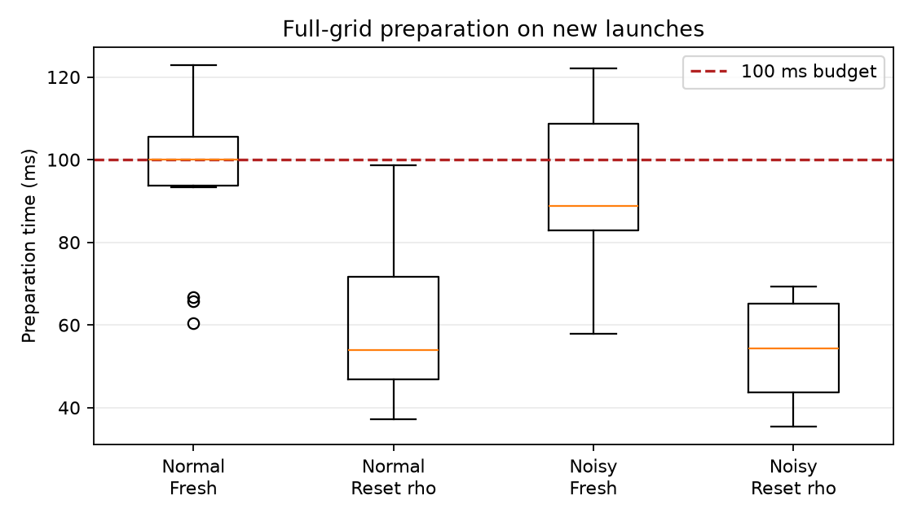

# Independent validation of full-grid OSQP reuse with rho reset

## Method and limits

The experimental `ResetRhoCalibrationMPC` runs the original full speed grid and preserves existing QP and nonlinear checks. When matrices, linear objective and solver settings match exactly within a calibration call, it updates the speed bounds, resets rho to 0.1, and resets primal and dual iterates. If these inputs differ, it creates a new solver. The existing `ReuseCalibrationMPC` keeps its prior behavior; neither experimental method is installed in the default controller.

The implementation temporarily patches the process-wide OSQP constructor: it is for **single-threaded experiments only**. Rho 0.1 is the fresh OSQP default used with this installed version; hard-coding it is not validated against altered settings or future versions. Independent states and deadline trials below are simulation evidence, not a mathematical proof or hardware real-time certification.

## Independent fixed-state audit

Seeds 1231 and 1232, cases 0–3, under normal and noisy observations produce 16 launch/profile combinations from eight different launches. Two combinations (case 2 of seed 1232) had no feasible anchor. In the remaining **14 planning states, 224 speed candidates** were each solved against identical state and QP inputs with a fresh solver, original reuse, and reset-rho reuse. All 224 fresh and reset-rho QP hashes and acceptance decisions matched; for 156 candidates where both QPs returned solved, the maximum absolute solution-vector difference was 0.0 in this run. Original reuse differed from fresh in one of the 224 decisions. Offline diagnostics run three solves and tracing per candidate; their elapsed times are not deadline performance measurements.

Each `snapshots` case directory contains candidate CSV and exact sparse QP and observed state NPZ files. The two no-anchor cases have no candidate files. This test covered changing QPs across separate states; a regression test also checks that the within-call cache rebuilds when a matrix or solver settings change and reuses when only bounds change.

## Independent 100 ms full-catch trials

Seeds 1222 and 1223, eight different throws each, are each tested in normal and noisy observation conditions, with both the fresh solver and reset-rho reuse (64 complete scoring runs plus fixture preparation). The same 16 physical launches are reused across the two profiles. The setup alternates method order and enforces the original 100 ms preparation budget. Medians exclude runs with no feasible anchor, for which preparation did not complete; they include runs that timed out and those with no certified speed.

| Profile | Method | Ready | Timed out | No anchor | No certified speed | Held | Held and compliant | Median preparation |
|---|---|---:|---:|---:|---:|---:|---:|---:|
| Normal | Fresh solver | 7 | 7 | 2 | 0 | 7 | 7 | 100.05 ms |
| Normal | Reset rho | 14 | 0 | 2 | 0 | 14 | 12 | 53.93 ms |
| Noisy | Fresh solver | 9 | 4 | 2 | 1 | 8 | 5 | 88.73 ms |
| Noisy | Reset rho | 13 | 0 | 2 | 1 | 10 | 6 | 54.37 ms |



In all **28** pairs that both reached the speed grid, stored intercept point, time, certified speed list and selected speed were identical. This compares separate executions, not a guarantee of identical actual robot or contact trajectories. Median paired time savings were 31.48 ms normal and 33.83 ms noisy. Catch/constraint results are included for transparency, but wall-clock load, command deadlines, small sample size and profiling can affect them; they should not be interpreted as a general probability improvement.

## Reproduce

```powershell
$env:OPENBLAS_NUM_THREADS='1'
python -m experiments.reset_rho_benchmark --seed 1222 --profile normal --output-dir runs/rho_normal_1222
python -m experiments.reset_rho_benchmark --seed 1222 --profile noisy --output-dir runs/rho_noisy_1222
python -m experiments.reset_rho_benchmark --seed 1223 --profile normal --output-dir runs/rho_normal_1223
python -m experiments.reset_rho_benchmark --seed 1223 --profile noisy --output-dir runs/rho_noisy_1223
python -m experiments.solver_snapshot_audit --seed 1231 --case 0 --profile normal --output-dir runs/rho_snapshot_1231_0
```

In benchmark CSV files, `method=reuse` refers to reset-rho reuse. The earlier seed 1221 pilot is archived but not included in the results. The independent fixed-state diagnostics retain all 224 QP snapshots for replay.

## Next

Before default use, replace the global patch with a scoped, thread-safe solver interface; derive the initial rho from explicitly declared solver settings rather than assuming 0.1; and validate on a substantially larger independent launch and disturbance set, including full grasp/impact metrics and representative system load. The fixed-intercept fixture is an experimental comparison tool; improvements here do not automatically accelerate or certify the main rolling interception controller. No machine learning is used.
