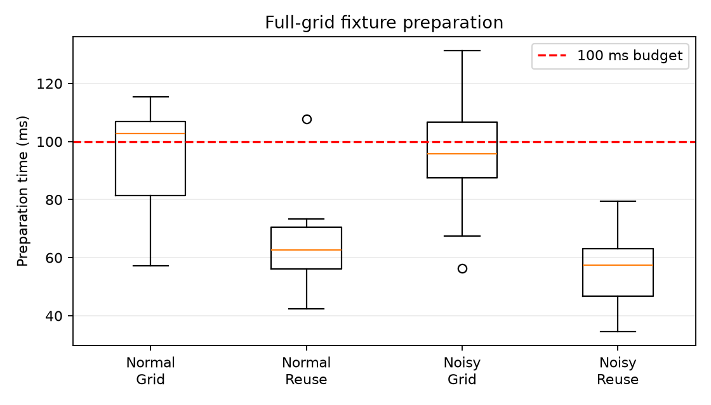

# Experimental OSQP reuse for full-grid fixture preparation

## Design

The baseline prepares an observation-derived fixture and checks the entire original speed grid. This experimental variant preserves the same grid, optimization objective, bounds, original 100 ms wall-clock budget, nonlinear terminal verification, and speed selection rule. Within a single calibration call it reuses an OSQP workspace only when the sparse P and A matrices, linear objective, dimensions and settings match byte for byte; otherwise it creates a fresh workspace. It changes bounds for each requested speed and explicitly resets primal and dual iterates to zero. Internal solver state such as adaptive penalty may still differ. This is an experiment: it temporarily patches the process-wide OSQP constructor and is **single-threaded only**; it is not integrated into the default controller.

The paired study uses seeds 1212 and 1213, eight physical cuboid launches each, under normal and noisy observation profiles. Both methods use each same launch and each profile; order alternates. Thus there are 16 different physical launches, 32 launch/profile combinations, 64 full catch runs, and separate preparation attempts. Catch runs include the existing wall-clock deadline policy. Pilot seed 1211 is archived separately and excluded below.

## Outcomes

| Profile | Method | Ready | Deadline timeout | No feasible anchor | No certified speed | Held | Held and compliant | Median preparation (ms) |
|---|---|---:|---:|---:|---:|---:|---:|---:|
| Normal | Fresh solver | 5 | 9 | 2 | 0 | 4 | 4 | 102.66 |
| Normal | Reused solver | 13 | 1 | 2 | 0 | 9 | 7 | 62.62 |
| Noisy | Fresh solver | 7 | 7 | 1 | 1 | 7 | 5 | 95.84 |
| Noisy | Reused solver | 15 | 0 | 1 | 0 | 10 | 8 | 57.39 |

Timing medians include completed grid preparation, even if it exceeded the deadline or no speed was certified; runs without a feasible anchor have no such timing and are excluded. Timing and success depend on machine load, run order and deadlines; these small-sample results are not a real-time guarantee. The 100 ms threshold is the existing simulated preparation budget, not hardware validation.



For all 29 pairs in which both methods reached the grid, the stored fixture point and time matched. **Feasible speed lists matched exactly for only 23/29 pairs**: 11/14 normal and 12/15 noisy. The `mid` requested speed matched in 12/14 normal and 13/15 noisy pairs. This includes cases that later timed out. On these matched-anchor pairs the median grid-minus-reuse preparation difference was 36.33 ms normal and 38.45 ms noisy. There were 15 workspace cache hits in each completed reused grid.

These differences mean the requested preservation of the certified speed set and selected speed has **not** been achieved. The experiment cannot establish numerical equivalence or attribute catch gains solely to timing. Reuse changes solver internal state despite zeroing iterates, and other run-to-run numerical effects are possible; the precise cause has not been isolated. Near feasibility boundaries, changed solver output may change the subsequent speed and trajectory. Do not promote this prototype to the operational controller.

## Next checks

Capture one actual planning state and solve each grid speed twice from that identical snapshot; compare status, residuals, solutions, OSQP adaptive-penalty state and post-check failure reasons. Then investigate a fully reset solver with fixed settings or reuse only invariant model matrices, and compare all certificates against fresh solves before repeating the deadline/catch benchmark. No machine learning is used.

## Reproduce

Run from the project root with dependencies installed:

```powershell
$env:OPENBLAS_NUM_THREADS='1'
python -m experiments.reuse_calibration_benchmark --seed 1212 --profile normal --output-dir runs/reuse_normal_1212
python -m experiments.reuse_calibration_benchmark --seed 1212 --profile noisy --output-dir runs/reuse_noisy_1212
python -m experiments.reuse_calibration_benchmark --seed 1213 --profile normal --output-dir runs/reuse_normal_1213
python -m experiments.reuse_calibration_benchmark --seed 1213 --profile noisy --output-dir runs/reuse_noisy_1213
```

All trial CSVs include raw certified level lists, requested speed, timing, cache counts and outcomes. The benchmark is single-threaded and must not run alongside another planner in the same Python process.
