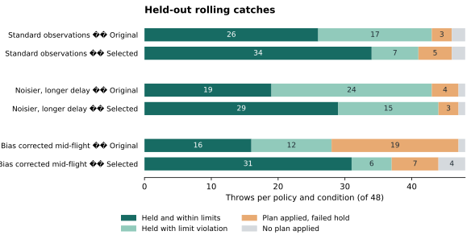

# 提高长抛滚动接球成功率

**推荐使用持续更新接点的 `track_reserve_edge`。** 与原滚动版在两批共 72 个相同的新球上对照，正常观测时抓稳从 56/72 增至 64/72，完整通过从 42/72 增至 55/72。噪声和延迟加倍时，抓稳从 59/72 增至 62/72，完整通过从 33/72 增至 47/72。

## 原版最常在哪里失败

统计[锁点实验](../lock_timing/README.md)中三批互不重叠的 96 个发射。每批只计首次运行的滚动策略，同一球在两种观测条件下配对。下表把每个球计入一个结果。抓稳要求主动计划真正下发、球未落地、首次触球后经过 0.3 秒过渡，再保持两秒手指连续接触且相对掌心漂移不超过 25 mm。完整通过还要求七关节全程实测速度 ≤1 rad/s、加速度 ≤4 rad/s²，位置与执行器力矩在限值内。

| 原版结果 | 正常（2 mm、20 ms） | 较差（4 mm、40 ms） |
|---|---:|---:|
| 没有下发可行主动计划 | 12 | 8 |
| 下发了计划，未抓稳两秒 | 10 | 5 |
| 抓稳，但机械臂超限 | 16 | 29 |
| 抓稳且全程合规 | 58 | 54 |
| 合计 | 96 | 96 |

正常和较差观测条件下，分别有 9 和 20 个已抓稳的球在触球后头 20 ms 内加速度超限。两组里分别有 6、8 个已抓稳球的关节速度越过 1 rad/s，超过幅度都小于 0.001 rad/s。两类可能重叠，仍按原始严格界限计分。没有下发计划的 12 和 8 个球全部出现在横向偏移较大的一半抛球（65–105 mm）。

## 三处改动

两版使用同一 xArm7、LEAP 手、60 g 小球、抛球分布、触觉闭指和接触后制动。各模式都用七个高度候选、20 ms 滚动规划、2 ms 力矩命令期限和 30% 末端速度软目标。低层触球前只接收延迟观测，首次接触后沿用仓库既有的仿真接触反馈。成功判据完全相同。

| 开关 | 控制器变化 | 希望解决的问题 |
|---|---|---|
| `track` | 第 8 帧送达后开始估计，最多保留最近 48 帧。先扣除已知重力，再拟合位置和速度。若近三帧相对旧拟合的平均偏移超过五倍预测标准差且最近两帧方向一致，尝试为新观测段单独估计位置偏移，两段共享弹道速度。 | 降低短窗口速度噪声，同时允许中途观测原点改变。 |
| `reserve` | 给规划器设 0.97 rad/s 速度上限，低层跟踪器设 0.985 rad/s 上限，评分线仍为 1 rad/s。 | 给跟踪误差和接触扰动留出关节速度余量。 |
| `wrist` | 将终端掌姿线性化误差约束从每分量 0.03 放宽到 0.085，目标朝向和姿态代价不变，关节、力矩、碰撞检查仍照常执行。 | 增加偏心来球附近的可达姿态。 |

开发使用种子 971–973，每个种子八个抛球。在正常和较差观测条件下比较全部八种组合。预定选择顺序是两个条件的完整通过数之和、两者较小的通过数、总抓稳数、开关更少、固定次序。接下来固定得分最高的挑战者，与原版在种子 981–986 上重新比较。第三种压力测试给较差观测叠加一个方向随机的 32 mm 水平偏差，在飞行中途纠正，控制器只能根据送达的观测自行处理。每个种子和球号使用同样的发射状态与配对噪声序列，轮换不同策略的执行顺序。各球都计入分母。

| 开发组策略 | 正常抓稳 / 完整通过 | 较差抓稳 / 完整通过 |
|---|---:|---:|
| rolling | 23 / 18 | 21 / 12 |
| track | 22 / 21 | 20 / 14 |
| reserve | 22 / 18 | 24 / 13 |
| wrist | 22 / 18 | 23 / 12 |
| track_reserve | 23 / 20 | 21 / 18 |
| track_wrist | 21 / 19 | 20 / 14 |
| reserve_wrist | 22 / 19 | 21 / 11 |
| track_reserve_wrist | 23 / 20 | 21 / 17 |

开发组选中 `track_reserve`，即 48 帧分段拟合加关节速度余量，保留原来的掌姿要求。各格分母均为 24。

## 第一批独立验证

每种条件均为同一批 48 个新抛球，每列按“原滚动版 → `track_reserve`”排列。逐球变化只计算完整通过的变化。“触球加速度超限”限定在已抓稳球的首次接触后 20 ms 内，“速度超限”看已抓稳球的全程。

| 观测条件 | 抓稳 | 完整通过 | 新通过 / 原通过但退步 | 抓稳球中触球加速度超限 | 抓稳球中关节速度超限 |
|---|---:|---:|---:|---:|---:|
| 正常 | 43 → 41 | 26 → 34 | 14 / 6 | 9 → 7 | 7 → 0 |
| 较差 | 43 → 44 | 19 → 29 | 15 / 5 | 14 → 13 | 9 → 0 |
| 偏差中途纠正 | 28 → 37 | 16 → 31 | 17 / 2 | 8 → 6 | 5 → 0 |



正常观测下新增 8 个完整通过，同时抓稳少了 2 球。较差观测下新增 10 个完整通过，抓稳多 1 球。两组分别从 7 和 9 个抓稳球关节速度超限降为零，触球加速度超限仍有 7 和 13 球。中途纠正偏差时，新版抓稳多 9 球、完整通过多 15 球。新版在 48 个注入偏差的球上都检测到一次位置转移，另两种条件均未触发。这项结果只针对设定的偏差幅度和形式。所有算法只看送达的观测，不读取偏差事件标签。单次相机采样与拟合的最大实测耗时为 0.59 ms 以内。运行仍按墙钟时间丢弃逾期控制命令，个别球可随运行负载改变结果。

这次按成功率选参数。第一批独立验证中，两版都抓稳的球数分别为 40、40、25。同一球的前 20 ms 峰值力差（新版减原版）中位数在正常、较差、偏差纠正三组依次为 +0.20、−0.23、+0.25 N，反向冲量差中位数分别为 +0.00036、+0.00032、−0.00162 N·s。不同条件下变化方向不同，成功率的提升不能推导出冲量也普遍降低。

## 偏心球的掌心落点

另外测试一条恢复规则。只要没有中心对准的计划实际下发，控制器就交替尝试正对球心和偏置掌心两种方案。当球在当前掌心高度的预计交点沿掌面偏离掌心超过 45 mm 时，第二种方案把目标掌心朝当前掌心方向移 16 mm。这让球可以从掌心稍偏的位置入手。触球预测仍使用原球轨迹，物理几何、手掌大小和材料均保持原设定。一旦中心对准计划真正下发，即恢复常规滚动选点。规则没有读取发射类别或将来的真实球位。

第一组使用 991–995 的 40 个新球。每种观测、每种策略均运行了全部 40 球。下表每格为“有主动计划 / 抓稳 / 完整通过”。

| 策略 | 正常 | 较差 |
|---|---:|---:|
| rolling | 34 / 31 / 23 | 36 / 33 / 21 |
| track_reserve | 34 / 33 / 31 | 34 / 31 / 26 |
| track_reserve_edge | 38 / 36 / 33 | 40 / 35 / 28 |

就其中 20 个大偏移抛球而言，新版加掌心偏置以后，正常观测下实际下发计划从 14 增至 18，较差观测下从 14 增至 20。完整通过分别从 12 增至 14、从 9 增至 11。配对看全部 40 球，正常观测下新增 4 个完整通过但另外 2 个退步，较差观测下相应为 3 和 1。新增的通过都计入原始 40 球分母。

## 第二批偏置复核与推荐版本

在查看最后一组数据前，固定 16 mm 偏置、45 mm 启用距离和其余全部参数。种子 1001–1004，每种观测 32 个新球。这次同时加入偏差中途纠正测试。每格为“抓稳 / 完整通过”。

| 策略 | 正常 | 较差 | 偏差中途纠正 |
|---|---:|---:|---:|
| rolling | 25 / 19 | 26 / 12 | 22 / 4 |
| track_reserve | 26 / 19 | 27 / 18 | 31 / 22 |
| track_reserve_edge | 28 / 22 | 27 / 19 | 31 / 21 |

最后 32 球单看完整通过，增加掌心偏置相对 `track_reserve` 在正常条件多 3 球、较差多 1 球、偏差纠正少 1 球。与最初滚动版相比，含偏置的版本在这三种条件分别多通过 3、7、17 球。

**用同两批 72 个球比较三个完整版本。** 分母为 40 + 32，每个发射状态在每种观测条件内只计一次。正常与较差观测复用相同发射状态。表中是各组抓稳数和完整通过数。

| 策略 | 正常抓稳 | 正常完整通过 | 较差抓稳 | 较差完整通过 |
|---|---:|---:|---:|---:|
| rolling | 56/72 | 42/72 | 59/72 | 33/72 |
| track_reserve | 59/72 | 50/72 | 58/72 | 44/72 |
| track_reserve_edge | 64/72 | 55/72 | 62/72 | 47/72 |

以原版为参照，对照同一球的完整通过结果，含偏置的版本在正常观测下新增 22 球、退步 9 球。较差观测下新增 22 球、退步 8 球。建议在这套长抛场景中使用 `track_reserve_edge`。单独看核心两项改动，三批独立验证共 120 个球，正常观测完整通过从 68 升至 84，较差观测从 52 升至 73。掌心偏置额外对照了其中两批共 72 球。第一批 48 球未运行偏置方案，不能并入该方案的分母。所有结果均为 MuJoCo 仿真，真实硬件的噪声、接触和运行时延需要另测。

## 数据与运行

[开发组 384 次](development.csv) · [独立复核 288 次](validation.csv) · [掌心偏置 240 次](reach.csv) · [第二批偏置复核 288 次](replication.csv)。[筛选与独立验证运行](https://github.com/Diara0430/MEAM5170-Final-Project/actions/runs/45770974113) · [偏置首轮运行](https://github.com/Diara0430/MEAM5170-Final-Project/actions/runs/45771504076) · [偏置复核运行](https://github.com/Diara0430/MEAM5170-Final-Project/actions/runs/45771990670)。

在仓库根目录的 Python 3.12 环境运行。批量对照使用单线程 OpenBLAS 与 OpenMP，可以重现发射和观测噪声序列。临界案例会受实际运算耗时影响。以下单策略命令各模拟八个确定种子的长抛。

```sh
python -m pip install -r scene_setup/requirements.txt
python -m unittest experiments.test_segmented_flight experiments.test_ball_observer experiments.test_lock_timing
python -m experiments.rolling_success --seed 981 --profile normal --policy track_reserve --output-dir results_local/track-reserve
python -m experiments.rolling_reach --seed 1001 --profile normal --core track_reserve --recovery-only --output-dir results_local/track-reserve-edge
python -m experiments.plot_rolling_success results/rolling_success
```
