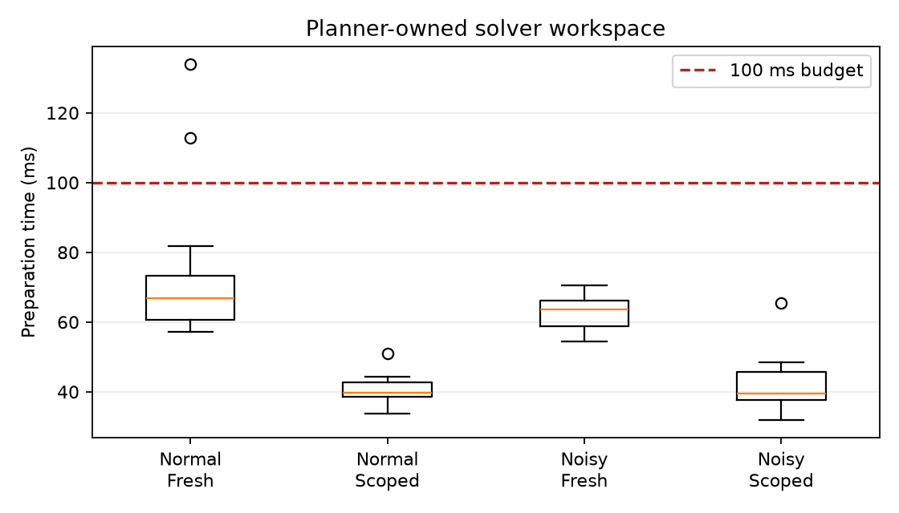

# Planner-owned experimental calibration workspace

## Implementation

The regular `CatchingMPC` now delegates solver construction to `_setup_qp_solver`; its default implementation still constructs a fresh OSQP instance with the previous settings. The experimental `ScopedCalibrationMPC` overrides that hook and owns a `CalibrationWorkspace`. The workspace is cleared at the start and in a `finally` block at the end of each calibration call, checks exact sparse matrix, objective and solver settings before reuse, resets rho to an explicitly supplied value (default 0.1) and resets primal/dual iterates. Changed matrices or settings create a new solver. Each planner owns its own lock and workspace; calls through one planner's calibration `solve` are serialized. Tests exercise two independent workspaces concurrently. This does not establish thread safety for arbitrary shared MuJoCo model/data, other controllers, or the timing experiment harness, which still uses temporary instrumentation patches. No global OSQP patch is used by the scoped planner itself.

This remains opt-in experimental calibration. It does not automatically accelerate the main rolling catch controller. The cache depends on the installed OSQP update behavior and the supplied initial rho; changing versions or settings requires revalidation.

## Fixed QP replay

All 224 previously archived QPs from the independent 1231/1232 fixed-state study were replayed using fresh solvers and the new workspace. QP hashes verified; all 224 statuses matched. Among 156 pairs with solved status, the maximum solution-vector difference was 0.0 in this run. This replay compares QP outputs only: it does not itself rerun nonlinear catch checks or represent newly sampled states. See `qp_replay.csv` and `experiments/scoped_qp_replay.py`.

## New full-catch timing study

Seeds 1242 and 1243 provide 16 physical throws. Each is run under normal and noisy observations, once per method (64 scoring simulations plus preparation); the same throws are reused across profiles. The fixture and full speed grid retain the original 100 ms wall-clock deadline. Median preparation time includes timed-out and no-certified-speed preparations, excludes no-anchor cases, and is machine/load dependent.

| Profile | Method | Ready | Timeout | No anchor | No certified speed | Held | Held and compliant | Median preparation |
|---|---|---:|---:|---:|---:|---:|---:|---:|
| Normal | Fresh | 11 | 2 | 2 | 1 | 9 | 8 | 66.95 ms |
| Normal | Scoped | 13 | 0 | 2 | 1 | 11 | 8 | 39.72 ms |
| Noisy | Fresh | 14 | 0 | 1 | 1 | 13 | 7 | 63.61 ms |
| Noisy | Scoped | 14 | 0 | 1 | 1 | 13 | 7 | 39.56 ms |



Both methods reached the grid with equal stored point and time in 29 pairs. All 29 selected the exact same requested speed. Speed lists were exactly equal in 28/29; in the other pair a nominal entry was 0.36394390048605824 versus 0.36394390048672742 m/s (difference approximately 6.7e-13 m/s). Thus equality within numerical tolerance was observed, not bitwise identity for every separately generated fixture. Median paired time savings were 23.48 ms normal and 22.07 ms noisy. Catch outcomes depend on deadline delivery, physical simulation and machine load; the sample is too small to claim general improvement or real-time guarantees.

## Reproduce

```powershell
$env:OPENBLAS_NUM_THREADS='1'
python -m experiments.scoped_calibration_benchmark --seed 1242 --profile normal --output-dir runs/scoped_normal_1242
python -m experiments.scoped_calibration_benchmark --seed 1242 --profile noisy --output-dir runs/scoped_noisy_1242
python -m experiments.scoped_calibration_benchmark --seed 1243 --profile normal --output-dir runs/scoped_normal_1243
python -m experiments.scoped_calibration_benchmark --seed 1243 --profile noisy --output-dir runs/scoped_noisy_1243
python -m experiments.scoped_qp_replay --input-dir results/reset_rho_validation/snapshots --output runs/scoped_qp_replay.csv
```

In the benchmark CSV `method=reuse` denotes the scoped implementation. The pilot is excluded from the table. The ordinary delayed-ball replay for seed 812 case 3 matched all four historical held/qualified/drift outcomes, and all 22 tests passed, including workspace isolation, changed-input fallback and invalid rho.

Next validate scoped calibration with a larger independent set and representative processing delays before adopting it for the fixed-intercept comparison; then return to the original angle/friction and grip-stability experiments. No machine learning is used.
