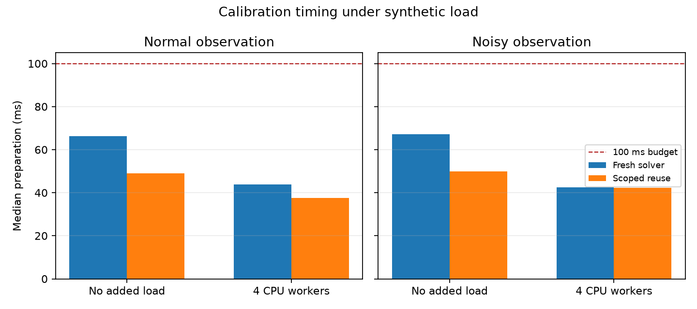

# Scoped calibration under measured synthetic CPU load

## Experiment

This study evaluates the opt-in `ScopedCalibrationMPC` against the original fresh-solver calibration on 16 new physical cuboid throws (seeds 1251 and 1252; eight cases each). Every throw runs under normal and noisy observation, with and without four synthetic CPU workers, for 64 launch/profile/load combinations and 128 scoring simulations. All methods keep the original full speed grid, 100 ms preparation deadline, fixed point/time and existing force/kinematic checks. The same physical throws are reused across observation and load conditions: they are not 64 independent throws.

The benchmark alternates method order within each throw. Four worker processes run busy integer arithmetic; recorded CPU times show approximately one CPU second per wall second for each worker. The machine reported 18 logical CPUs: workers were not pinned to the planner's core, so this is a measured synthetic background workload, not guaranteed contention or a worst-case hardware load. No-load means no workers were deliberately started by this script, not that the computer was otherwise idle. The eight runs were sequential, not randomized or interleaved at the per-trial level; time, scheduling, thermal and other processes can confound cross-load comparisons. The benchmark harness still uses temporary global instrumentation patches and is single-threaded; the scoped controller itself does not use those patches.

An initial Windows run recorded CPU time for the virtual-environment launcher instead of its underlying worker. That measurement was invalid and is excluded. The corrected script launches the base interpreter directly, verifies every worker consumed positive CPU time, records metadata, and terminates each worker. No test worker remained after the experiment. This script requires the optional `psutil` package.

## Results

All columns in each row use 16 paired throws. Medians include all completed speed-grid preparations, even if they exceeded 100 ms; no-anchor cases have no completed preparation and are excluded from timing medians. Held/compliant values use the original scorer and count all 16 throws, including no-anchor and timeout outcomes.

| Background | Observation | Fresh ready / held / compliant | Scoped ready / held / compliant | Fresh / scoped median preparation |
|---|---|---:|---:|---:|
| No added workers | Normal | 11 / 10 / 6 | 13 / 12 / 8 | 66.30 / 49.02 ms |
| No added workers | Noisy | 12 / 5 / 3 | 13 / 7 / 4 | 67.25 / 49.91 ms |
| Four workers | Normal | 13 / 12 / 8 | 13 / 12 / 8 | 43.79 / 37.51 ms |
| Four workers | Noisy | 13 / 6 / 4 | 13 / 6 / 4 | 42.50 / 42.18 ms |



Each row has three no-anchor throws per method. Fresh solver timeouts were 2 and 1 in the two no-added-worker conditions, and 0 in both four-worker conditions; scoped solver had no timeouts in this sample. Both methods reached the speed grid and shared the exact stored point and time on 13 pairs per row. All 52 such pairs had exactly the same recorded certified-speed lists and target speed. Median pairwise fresh-minus-scoped time was 13.94 / 17.80 ms in normal / noisy no-added-worker runs, and 7.75 / 1.20 ms with four workers. Both methods were faster on the later measured load sessions; the design cannot identify why, and does not show that extra CPU work improves performance. Timings and event delivery depend on machine load, scheduling and other conditions; these results do not demonstrate worst-case deadlines or prove causal performance gains.

## Catch stability remains a separate limitation

Under four workers and noisy observation, both methods applied active plans in 13/16 throws but met the full hold criterion in 6/16: seven applied-plan trials did not meet the hold criterion. This small set indicates that improving calibration time alone does not solve grasp retention. The logs do not by themselves identify whether each failure arose from bounce, slip, hand closure, impacts or other causes; inspect contact traces and replay the same launches before assigning causes. The main rolling interception controller is not automatically accelerated by this experimental fixture optimization.

## Reproduce

Install project dependencies plus `psutil`, then from the repository root:

```powershell
$env:OPENBLAS_NUM_THREADS='1'
python -m experiments.load_scoped_benchmark --seed 1251 --profile normal --load-workers 0 --output-dir runs/scoped_idle
python -m experiments.load_scoped_benchmark --seed 1251 --profile normal --load-workers 4 --output-dir runs/scoped_load
python -m experiments.analyze_scoped_load runs/scoped_idle runs/scoped_load --output-dir runs/scoped_summary
```

`load-workers` is limited to four. Raw trial CSV and per-session worker CPU metadata are included. `analysis/pairs.csv` preserves all method pairs and `analysis/summary.csv` gives counts. The pilot/invalid CPU measurement sessions are not used in this report. Results remain experimental and do not change the default controller. No machine learning is used.
