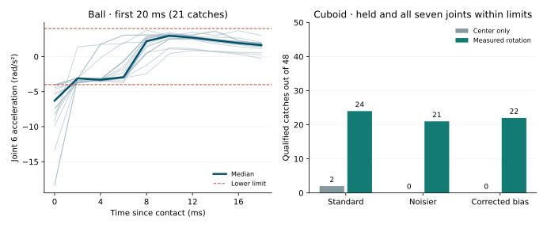

# 七轴接取长抛球和自旋长方体

[观看长方体仿真回放](catch.gif) · [下载对应的机器人和物体状态](replay.json.gz) · [返回早期球体实验](../intercept_impact/README.md)

球体沿用滚动接点基线 `track_reserve_edge`。标准观测下，给第六轴加短时正向补偿是一个可复现的选项。长方体首先要把估计的姿态与自旋放进触球前的一步动力学预测。只追踪质心时，手能接住许多长方体，但在错误的物体姿态上估算接触，七轴加速度经常超限。



## 统一条件

- xArm7 和 LEAP 手。球直径 50 mm，长方体尺寸为 64 × 42 × 34 mm，均重 60 g，使用原模型的材料和执行器。每种子 8 次随机长抛，设计飞行时间 0.90–1.18 s。比较方法共享发射位置、速度、姿态、自旋与观测随机数。不同观测条件也重用同一批发射。
- 相机 50 Hz，控制仿真每 2 ms 积分一次，拦截规划预算 20 ms。标准条件为位置噪声 2 mm、延迟 20 ms。较差条件为 4 mm、40 ms。偏差纠正条件另在早期观测中加入横向 32 mm 偏差，之后撤去。长方体在随机初始姿态和随机自旋轴上测试，初始角速率覆盖 0、0.8、2、3 rad/s。
- 主动抓稳要求命令已下发，物体未落地，首次接触后经过 0.3 s 过渡，接下来 2 s 内持续有手指接触且相对掌心最大位置漂移 ≤25 mm。完整合规还要求七轴全部时刻速度 ≤1 rad/s、加速度 ≤4 rad/s²、位置与执行器力矩都在模型限制内。长方体另记相对手掌的最大角位移，便于识别物体在手中转动的情况。被动手掌对照允许零条主动命令，单列评价。
- 早期峰值力是前 20 ms 手对物体矢量合力的峰值。反向冲量是该窗口内沿首次来物反方向的积分。影子对照做同样的候选计算，最终仍下发原指令。控制器按实际墙钟时间拒收迟到的指令，重复运行同一个发射也可能得到不同结果。所有数据来自仿真。

## 球体失效定位

回放 1041–1046 的全部 48 个发射，各用两种观测。每次首触后保存 10 个物理步的七轴位置、带符号加速度、手部接触连杆和法向载荷。逐球断言新记录的加速度峰值等于原评分程序的结果。首个时刻 0 ms 表示区间 [0, 2) ms。

| 条件 | 原实验抓稳但早期超限 | 原失败中复现 | 本次回放抓稳但早期超限 | 第六轴在第一步越限并且出现窗口最大值 |
|---|---:|---:|---:|---:|
| 标准 | 6 | 5 | 5 | 5 |
| 较差 | 17 | 15 | 16 | 16 |

21 次首步越限的第六轴加速度均为负，范围 −18.35 至 −4.02 rad/s²。首次接触时，14 次主要载荷出现在 `hand/mcp_joint_2`，2 次在 `hand/mcp_joint_3`，5 次在掌面。5 次有其他关节同时超限。回放记录和旧结果按发射一一匹配，以上部位和方向统计来自本次实际复现的 21 次。

## 球体的三项控制实验

1. **调整预计力臂**（`lever`）。按预计接触姿态、掌面法向和第六轴转轴，沿掌面改变接点最多 4 mm，缩小法向载荷对第六轴的力矩。旧种子较差观测下，合规由 24/48 升到 35/48。新种子 1061–1066 下，标准条件由 36 降至 33，较差条件由 31 升至 32。
2. **估计提前和滞后到达两种情况**（`wrist`）。在两种来球位置上试算第六轴扭矩，只有同时通过一步检查且预测最坏情形改善才下发。在 1061–1066 的新种子上，标准条件只有 3 球实际执行，较差条件有 4 球。合规分别为 34/48、32/48，对应原基线为 36、31。
3. **首触前正向补偿**（`preload`）。延迟估计显示物体距掌面或指根不到 27 mm 时，尝试使自由机械臂的第六轴正向加速度增加至多 2 rad/s²，目标最高 2.8 rad/s²。每条候选同时在自由和预计接触状态复核七轴，并受力矩、速度、行程和 2 ms 时限约束。真实触觉信号到达就退出。未改变关节标准、物体材料或实际状态。

下表每格为**抓稳 / 全程合规**，每组 48 个发射。1091–1096 用于首次验证，1101–1106 用于独立复核。

| 种子与观测 | 原基线 | 同计算影子对照 | 正向补偿 | 基线 / 补偿的抓稳球中早期加速度超限 |
|---|---:|---:|---:|---:|
| 1091–1096 标准 | 43 / 34 | 42 / 32 | 43 / 37 | 8 / 5 |
| 1101–1106 标准 | 44 / 36 | 45 / 39 | 43 / 40 | 7 / 2 |
| 1091–1096 较差 | 44 / 33 | 43 / 31 | 43 / 34 | 8 / 6 |
| 1101–1106 较差 | 44 / 38 | 42 / 35 | 42 / 34 | 4 / 3 |
| 1101–1106 偏差纠正 | 40 / 27 | 39 / 28 | 40 / 29 | 7 / 6 |

标准条件合计 96 个发射中，抓稳由 87 变为 86，完整合规由 70 增至 77，抓稳球中首触 20 ms 内超限的由 15 降到 7。较差条件的完整合规合计由 71 变为 68。复核批次较差观测下，补偿组全程飞行段出现过加速度超限的发射有 7 个，基线有 3 个。该策略的采用应区别观测条件。标准两批的双方合规样本上，早期冲量差的配对中位数分别为 −0.092 和 −0.094 mN·s，峰值力差分别为 +0.002 和 +0.002 N；减少超限的效果明显大于对接触力和冲量的影响。

## 长方体主动接取

延迟相机分别测量质心和带噪声的物体姿态。七帧姿态窗口在旋转空间拟合局部角速度，和质心抛物线一起外推。姿态观测各轴噪声在标准条件为 1°，另两种条件为 2°。真实发射四元数与自旋只用于初始化物理模型。触球前低层预测中，`center` 只重建质心，使用固定朝向、零自旋。`pose` 将已经送达的姿态估计及角速度也写入预测的物理状态。两者的真实长方体始终在自由转动。姿态测量由模拟传感器生成，尚未实现从 RGB 或深度图提取姿态。MuJoCo 自由关节的角速度使用物体坐标系。[MuJoCo 文档](https://mujoco.readthedocs.io/en/3.15.0/index.html)

- 开发集 1051–1053，每种条件 24 球。14 个方法覆盖质心、姿态、几何厚度补偿、单高度、四帧稳定后锁点、零目标速度、非线性速度、固定终点速度微调、短预演、掌面偏置、惯性重排、完整预演、按速度排序与提前准备速度。
- 按标准与较差条件的合规总数、较差组别的合规数、抓稳总数和固定方法顺序依次选出 `preview`（16/24、14/24）。开发集两种条件实际换到第二名的次数都是零，因此这个排名不足以将收益归因于重排。随后的 1071–1076 独立验证同时保留普通姿态版。
- 长方体还测试了按预计指间宽度调整拇指预形和食指闭合终点，以及在已有支撑且出现滑移时对承载手指增加少量闭合。诊断用实际仿真姿态测量手中的旋转。防滑反馈沿用仓库已建的仿真接触载荷和物体相对掌心位移。

| 同一批 48 个发射，抓稳 / 合规 | 标准 | 较差 | 偏差纠正 |
|---|---:|---:|---:|
| 球，原基线 | 39 / 33 | 41 / 29 | 41 / 29 |
| 长方体，只用质心 | 33 / 2 | 38 / 0 | 35 / 0 |
| 长方体，加入姿态和自旋 | 32 / 24 | 38 / 21 | 37 / 22 |
| 姿态 + 完整接触预演 | 35 / 26 | 38 / 21 | 37 / 23 |
| 完整预演 + 按宽度预形 | 33 / 24 | 34 / 22 | 36 / 23 |
| 完整预演 + 预形和防滑 | 32 / 23 | 38 / 24 | 37 / 24 |
| 姿态 + 第六轴力臂调整 | 33 / 25 | 38 / 27 | 35 / 27 |
| 姿态 + 第六轴正向补偿 | 32 / 22 | 41 / 24 | 35 / 22 |

同一批里，标准、较差、偏差纠正三组，加姿态后相对质心对照新增合规球分别为 23、21、22 个，丢掉原合规球分别为 1、0、0 个。早期加速度超限的抓稳球由 31、37、35 个减到 6、17、13 个。两种策略都抓稳的配对样本里，前 20 ms 的关节加速度峰值差中位数分别为 −12.31、−7.59、−12.46 rad/s²。三组峰值力差中位数为 +0.54、+0.02、+0.58 N；这次明确改善的是关节响应。

标准条件下，普通姿态版首次下发主动计划、首次实际接触的中位时刻分别为 0.18 s、1.05 s。触球前掌心相对初始位置最大移动距离的中位数为 78 mm。提前约 100 ms 做出的预测在实际触球时，质心误差中位数分别为 1.98、2.52、3.20 mm，姿态误差分别为 3.02°、6.58°、6.52°。此处用当时已经收到的测量外推到同一实际时间。开发集旧版的 100 ms 列曾把时间取到最近的相机采样点，定量精度使用此独立验证的修正版。普通姿态版三个条件的抓稳球中，最大相对转动 ≤15° 的分别为 21/32、24/38、20/37。15° 只作为附加说明，不改变原有合规判分。

## 固定同一接点和时间时，速度能否改变

另取 1081–1083 的 24 个发射，按延迟观测寻找共同的时空接点和可行末速，对每球试验固定原目标、最低、中间与最高可行速度。另设停在原位的手掌和动态滚动选点两种对照。独立验证每次下发的固定接点与时间，标定失败的发射保留在分母里。

| 条件，每格抓稳 / 合规（24 次） | 手掌固定 | 滚动选点 | 固定接点原速度目标 | 低 | 中 | 高 |
|---|---:|---:|---:|---:|---:|---:|
| 标准 | 12 / 10 | **22 / 21** | 18 / 15 | 13 / 11 | 14 / 11 | 16 / 12 |
| 较差 | 12 / 10 | **19 / 15** | 14 / 8 | 18 / 12 | 15 / 8 | 15 / 10 |

标准条件有 18/24 个发射获得可行速度，较差条件有 20/24 个。标准条件下三个速度档都抓稳的 11 个相同发射中，最低、中间、最高档实际触球的顺物速度中位数为 0.014、0.209、0.430 m/s。速度确实能改，固定高速度的整体合规数仍落后于滚动选点。较差条件同样有 11 个三档都抓稳的发射；个别球只有一个可行速度，低档与中档可能重合。

## 在第二批独立长方体上复核力臂改动

种子 1111–1116。每个条件以 48 个相同的发射比较姿态版、改变力臂的版本及其影子。正常、较差、偏差纠正三组分别有 45、44、44 个发射真正下发了掌面偏置。

| 观测，每格抓稳 / 合规 | 姿态版 | 缩短力臂 | 影子对照 | 与姿态版相比新增 / 丢失的合规发射 |
|---|---:|---:|---:|---:|
| 标准 | **45 / 39** | 40 / 34 | 44 / 38 | 5 / 10 |
| 较差 | 40 / 21 | **36 / 25** | 39 / 23 | 10 / 6 |
| 偏差纠正 | 32 / 20 | **34 / 26** | 34 / 22 | 12 / 6 |

两批较差条件下，普通姿态版合计 78/96 抓稳、42/96 完整合规，缩短力臂版为 74/96、52/96。两批偏差纠正条件下，抓稳数同为 69/96，完整合规由 42/96 升至 53/96。标准条件下完整合规由 63/96 变为 59/96。复核批次双方均合规的同一发射上，三组的早期反向冲量变化中位数为 +1.51、+2.15、+3.57 mN·s。因此把 `pose` 作为长方体通用演示版；在高噪声条件下更关注关节合规时，可以单独选择 `axis_lever`，同时报告抓稳数和冲量。

## 看演示与复现

回放在开始独立验证前指定种子 1071、第 0 次抛掷、标准观测、普通姿态版。初始自旋 3 rad/s，首次接触在 0.934 s；抓稳两秒，相对掌心最大平移 1.15 mm，全程最大关节加速度 3.79 rad/s²。回放按当下可用的观测与规划画点，含整机视角和掌面近景。对应的 50 帧、姿态、掌心位置和拦截点已随动画保存。[观看 GIF](catch.gif) · [原始回放](replay.json.gz)

在仓库根目录安装 `scene_setup/requirements.txt` 后运行。生成 GIF 还需要 Pillow 以及当前环境可用的 MuJoCo 渲染后端。Linux 无显示环境下，工作流使用 OSMesa。批量比较将 `OPENBLAS_NUM_THREADS` 设为 1。

```bash
python -m experiments.contact_joint_replay --seed 1046 --profile noisy --output-dir runs/ball_replay
python -m experiments.wrist_preload --seed 1101 --profile normal --output-dir runs/ball_preload
python -m experiments.shape_catch --seed 1071 --profile normal --methods center pose --output-dir runs/box_pose
python -m experiments.shape_catch --seed 1111 --profile noisy --methods pose axis_lever axis_lever_shadow --output-dir runs/box_lever
python -m experiments.shape_catch --seed 1071 --profile noisy --methods preview --grasp aperture_slip --output-dir runs/box_grip
python -m experiments.box_fixed_speeds --seed 1081 --profile normal --output-dir runs/fixed
python -m experiments.shape_replay --seed 1071 --case 0 --profile normal --method pose --output-dir runs/movie
python -m experiments.plot_shape_transfer results/shape_transfer
```

## 实验记录

共 4,320 次完整试验，使用 336 个不同发射编号。每次试验对应一个发射、观测条件、物体和策略的组合。重复研究中相同的发射编号只计一次。固定速度实验的标定前缀和额外演示不计入 4,320 次。

| 阶段 | 完整试验 | 逐球记录和运行 |
|---|---:|---|
| 球体首触诊断 | 96 | [逐球结果](ball_replay.csv) · [960 个物理步](ball_frames.csv) · [运行](https://github.com/Diara0430/MEAM5170-Final-Project/actions/runs/45789537385) |
| 球体力臂与不确定到达补偿 | 960 | [数据](ball_wrist_trials.csv) · [运行](https://github.com/Diara0430/MEAM5170-Final-Project/actions/runs/45790372531) |
| 球体正向补偿两批 | 288 + 432 | [首批](ball_preload.csv) · [复核](ball_replication.csv) · [复核运行](https://github.com/Diara0430/MEAM5170-Final-Project/actions/runs/45792612236) |
| 长方体 14 策略开发集 | 672 | [数据](box_screen.csv) · [运行](https://github.com/Diara0430/MEAM5170-Final-Project/actions/runs/45790567245) |
| 长方体独立验证与同发射球体对照 | 1,152 | [数据](box_confirmation.csv) · [运行](https://github.com/Diara0430/MEAM5170-Final-Project/actions/runs/45792259680) |
| 长方体固定时空接点速度对照 | 288 | [数据](box_fixed_speeds.csv) · [运行](https://github.com/Diara0430/MEAM5170-Final-Project/actions/runs/45791612419) |
| 长方体力臂独立复核 | 432 | [数据](box_lever_replication.csv) · [运行](https://github.com/Diara0430/MEAM5170-Final-Project/actions/runs/45793150373) |
