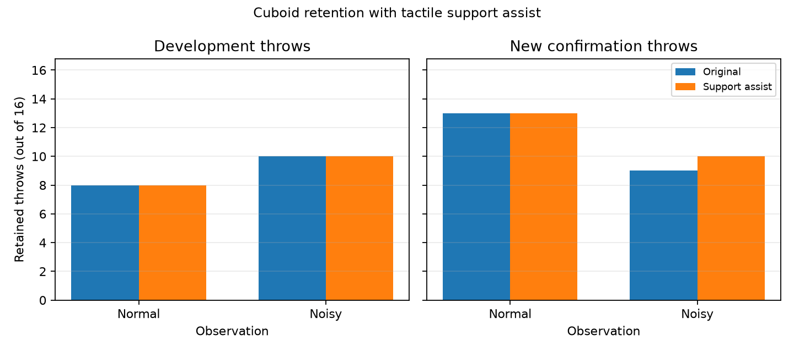

# Sustained tactile support assist for cuboid catches

## Control hypothesis

The prior fixed-intercept audit showed that some failures lacked sustained opposing support or lost it after first contact. This experiment tests a small, time-limited assist; it does not use the true cuboid state, future trajectory or eventual outcome. It reads only the preceding completed MuJoCo contact step through `ContactClosure`.

The original `SphereCageClosure` remains the nominal hand controller. Between 20 and 240 ms **after the close command**, when stable opposition is absent and contact is currently loaded or was loaded in the previous 30 ms, the assist gently retreats loaded digits and advances unloaded digits. It ramps a per-digit bias at at most 1 rad/s and tapers that bias to zero outside the active interval or after stable opposition. The bias target is -0.025 rad for a loaded finger and +0.065 rad for an unloaded finger, weighted per flexor. The extra actuator command corresponds to at most 0.25 N m per flexor; actuator position and original force limits still apply. This is not a 0.25 N m limit on contact force, and a change cannot be equated to measured hardware force. Because the bias tapers, its command can persist briefly after the active decision window.

In the present trials, closing began 2 ms after first contact in each contacted assist trial, so the earliest active decision was approximately 22 ms after the recorded first-contact timestamp. The existing 20 ms impact window therefore mostly precedes the intervention. The shadow method computes the same assist and diagnostics but leaves actuator commands unchanged.

## Paired trials

Two development seeds (1261, 1262) and two new confirmation seeds (1271, 1272), eight throws per seed, each under normal and noisy observations and three policies: original, shadow, assist. That is 32 distinct physical launches and 192 full scoring runs. The same physical launch is reused across observation conditions. Each policy separately prepares the scoped fixed-intercept fixture, with original 100 ms deadline, then runs the existing force-limited controller and scorer. Execution order rotates across throws. Per-step contact instrumentation and actual wall-clock planner/command deadlines can affect outcomes, so this is not a perfectly deterministic counterfactual.

Each table cell is `retained / retained and seven-axis compliant` out of 16 throws for that profile and batch. Non-applied plans and failed fixtures remain in denominators.

| Batch | Observation | Original | Shadow | Assist | Assist gains / losses vs original |
|---|---|---:|---:|---:|---:|
| Development | Normal | 8 / 7 | 8 / 7 | 8 / 6 | 0 / 0 |
| Development | Noisy | 10 / 7 | 10 / 7 | 10 / 7 | 0 / 0 |
| Confirmation | Normal | 13 / 12 | 13 / 12 | 13 / 12 | 1 / 1 |
| Confirmation | Noisy | 9 / 6 | 9 / 6 | 10 / 6 | 1 / 0 |



The assist delivered nonzero additional commands in 8/16, 8/16, 12/16 and 14/16 throws respectively. The largest recorded added actuator torque-equivalent command was 0.25000000000000133 N m (floating-point tolerance). Shadow delivered no extra commands and had the same hold and full-compliance counts as original in these trials. Shadow agreement does not eliminate all timing confounding.

In the confirmation normal group, seed 1271 case 4 was retained by original and dropped with assist; seed 1272 case 7 showed the opposite. In confirmation noisy, seed 1272 case 3 was rescued physically but remained noncompliant. Thus the fixed rule is **not promoted** to the default hand controller: the sample is small, effects are mixed, and a single new noisy-profile gain is insufficient to establish robust improvement.

Across pairs where both original and assist retained the object, median differences in first-20-ms impulse and peak seven-axis acceleration were zero in all four groups. Since the assist begins after that window, this observation is expected and does not demonstrate improved impact cushioning. The medians of 100 ms relative translation and rotation differences were approximately zero in these subsets; this does not exclude individual changes. `analysis/pairs.csv` keeps all outcomes and per-pair metrics, including cases that were not retained. `same_fixture` uses 1e-9 tolerance on point, time and requested speed; a missing fixture is not counted as a match.

## Watch an example

The example is a separate rerun of confirmation seed 1271 case 4; it again retained with original and failed with assist. Rendered GIFs: [original](example_1271_4/original.gif) and [assist](example_1271_4/assist.gif). Both contain the saved physical trajectories and close-up. Results of additional reruns can differ due to real wall-clock deadlines. To play saved frames in the MuJoCo viewer:

```powershell
& 'D:\test code\.venv\Scripts\python.exe' -m experiments.view_cuboid_audit results/sustained_support/example_1271_4/assist_replay.json.gz --speed 0.25 --loop
```

From the repository root, reproduce one seed/profile and the optional paired animation:

```powershell
$env:OPENBLAS_NUM_THREADS='1'
python -m experiments.sustained_support_study --seed 1271 --profile normal --output-dir runs/support_1271
python -m experiments.support_replay --seed 1271 --case 4 --profile normal --output-dir runs/support_replay --render
```

All raw per-trial CSVs and aggregated paired CSVs are archived. Twenty-three tests passed, including a focused check that shadow does not change commands and the assist obeys its per-step bias and added-torque limits. No machine learning is used.

## Next

Investigate the opposing 1271/4 and 1272/7 outcomes using contact-by-contact forces, contact location, actual slip and finger-relative motion under synchronized recorded control decisions. A more targeted, geometry-aware rule should only be evaluated on fresh launches, with shadow controls and explicit impact, retention and joint-constraint metrics. First-impact cushioning and long-term slip resistance remain separate unresolved goals.
