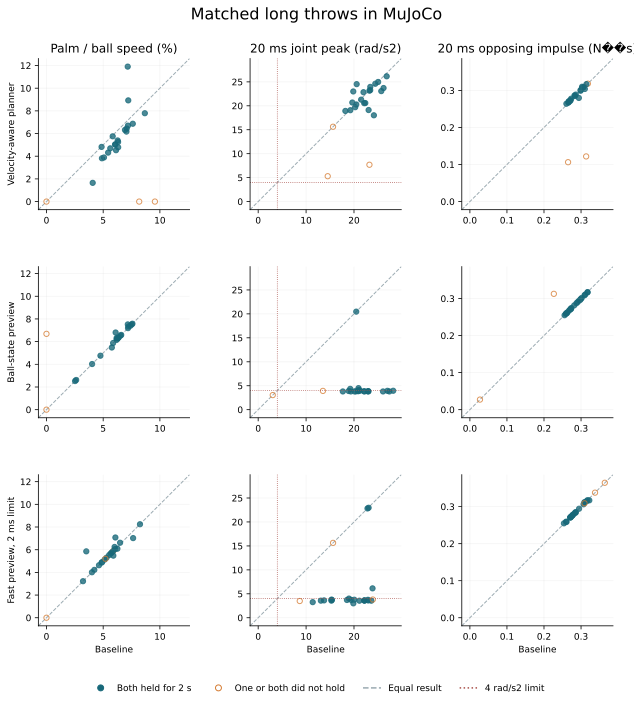

# 长抛接球的速度选点与首次接触控制

下一阶段的[固定接点速度对照及首次接触复盘](../fixed_speed/README.md)给出了独立测试结果和逐球曲线。

在最后一批 24 个新抛球上，限时修正版主动留住 19 球，12 球通过全部关节和抓持判据。同组快速接触预测基线留住 18 球、4 球完整通过。两者均对超过 2 ms 的低层命令执行丢弃。新增的 8 个合格抛球均来自此前未合格的配对，原有 4 个全部保留。

每套实验都用相同的七个候选高度、30% 速度目标、50 Hz 三维位置观测、20 ms 测量延迟和每轴 2 mm 标准差的测量噪声。每个随机种子有八次长抛，各策略在同一抛球上配对。手指触发方式、球和手的材料参数、七轴限位与合格线都相同。

## 选择接点能让掌心跟上球吗？

原有 MPC 在候选轨迹上已经优化了终端速度误差。新方案在每个候选的非线性终端关节姿态重新计算掌心雅可比，以可实现的掌心速度评估法向接近速度和切向滑动，并考虑位置误差与平滑制动后的关节余量。第二个版本还在到点前 60 ms 的关节参考中加入沿来球方向的速度目标。

| 24 球一组 | 原七高度方案 | 按可实现速度重排 | 重排并提前顺球加速 |
| --- | ---: | ---: | ---: |
| 开发组主动保持两秒，种子 821–823 | 22 | 21 | 22 |
| 新种子主动保持两秒，种子 831–833 | 22 | — | 21 |
| 新种子通过完整判据 | 0 | — | 0 |

开发组用预先写入代码的规则选出一个挑战方案。先比较完整通过数，再比较主动保持数，然后按同球的冲击指标打破平局。进入复核的是提前顺球加速版本。新种子中两组都留住的 21 球，终态模型预测的速度匹配率中位数为 5.26%，实际达到 5.25%，原版实测为 6.28%。19 球的实测速比下降，末次选定高度相差超过 10 mm 的只有 2 球。掌心距选点的中位数从 6.50 mm 增至 8.32 mm。

## 从已观测的球状态预测首次接触

保留原七高度规划器。当估计球心距掌心捕获中心不足 10 cm 并朝掌面飞行时，把拟合的三维位置、速度写入独立的动力学预测模型，用该模型算下一步七轴命令。真实仿真球仍自由运动。第一次观测到触觉信号后，控制器切回共同的接触反馈。

| 种子 841–843，各 24 球 | 只预测机械臂 | 同时预测球与手接触 |
| --- | ---: | ---: |
| 主动留住两秒 | 21 | 22 |
| 完整通过 | 0 | 13 |
| 共同留住的 21 球，20 ms 关节加速度峰值中位数（rad/s²） | 21.00 | 3.84 |
| 同一批球，20 ms 反向冲量中位数（N·s） | 0.282 | 0.282 |
| 同一批球，20 ms 手对球的合力峰值中位数（N） | 29.0 | 30.5 |
| 共同留住的球，首次接触步控制计算中位数（ms） | 0.35 | 3.53 |

这组实验记录了计算超时，仍在当前仿真步施加命令。13 个完整通过的球在首次接触步均超过 2 ms。其改善主要体现在机械臂对冲击的加速度响应，手对球的峰值力反而略有上升。

## 2 ms 内交付命令

种子 851–853 使用独立的 24 个抛球。每个物理步都测量机械臂低层求解器的运行时间。超过 2 ms 就丢弃本步的新机械臂执行器命令，继续发送上一步的目标。规划仍有独立的 20 ms 限制。计时不包含相机、上层规划、手指控制和 MuJoCo 的真实物理推进。

| 限时控制器，各 24 球 | 主动留住 | 完整通过 | 超时丢弃命令 / 控制步 |
| --- | ---: | ---: | ---: |
| 原求解器，仅机械臂 | 10 | 0 | 6,539 / 31,776 |
| 原求解器，预测接触 | 11 | 0 | 9,022 / 31,595 |
| 快速求解器，仅机械臂 | 21 | 0 | 0 / 38,771 |
| 快速求解器，预测接触 | 21 | 2 | 0 / 38,771 |

快速版以关节惯性矩阵近似力矩对加速度的影响，最多尝试三次修正。每次都通过完整的单步动力学模型检验，再决定是否采用。两种快速控制器都留住的 21 球，预测接触使触球后 20 ms 的峰值关节加速度中位数从 20.06 降到 3.62 rad/s²。反向冲量中位数分别为 0.2782 和 0.2783 N·s，合力峰值中位数分别为 29.79 和 30.17 N。带接触预测时，16 个留住的球在首次触球前仍超过 4 rad/s²，这成为下一项修正的目标。



图中每个点表示同一个球的两种控制结果。每行使用同一组种子，分别对应 831–833、841–843 和 851–853。第三行横轴和纵轴都使用快速求解器及 2 ms 限时。空心点包含未能主动保持的情况。只有两种策略都测到接触的抛球才能绘制冲量或接触实测速比。

## 限时力矩修正的独立复核

种子 861–863 在设计修正算法时未参与调参。两组都使用原七高度选点、快速接触预测和 2 ms 命令截止时间。当惯性近似仍预测关节超限，修正版尝试上一步力矩，并在有时间时用局部有限差分估计力矩响应。它保留已经过动力学检验的最好候选，在 80% 周期预算时停止启动额外的修正计算。总耗时仍受同一个 2 ms 执行判据约束。

| 各 24 球 | 快速接触预测 | 快速接触预测加限时修正 |
|---|---:|---:|
| 主动留住两秒 | 18 | **19** |
| 完整通过 | 4 | **12** |
| 每个种子的完整通过数（861 / 862 / 863，各 8 球） | 3 / 1 / 0 | 5 / 3 / 4 |
| 低层超时丢弃 / 控制步 | 1 / 36,997 | 1 / 36,991 |
| 首次触球步超时 | 0 | 0 |
| 共同留住的 18 球，触球前关节加速度峰值中位数（rad/s²） | 4.46 | **3.79** |
| 同一批球，首次接触后 20 ms 反向冲量中位数（N·s） | 0.287 | 0.284 |

修正版 19 个主动保持的球中，触球前超过 4 rad/s² 的有 0 个。7 个保持成功但未完全合格的球里，6 个在触球后 20 ms 内加速度超限，另 1 个的实测速度约为 1.0001 rad/s。其余 5 个球中，4 个没有下发可行计划，1 个下发计划后未完成保持。下一次可分别复盘首次接触的预测误差和四个未获可行计划的抛球。不同种子组的比例分别报告，同一行内可作配对比较。

## 判据、数据与复现

一次主动保持要求机械臂至少执行过一个接取计划，球未落地，首次触手后经过 0.3 秒的过渡，之后连续两秒有手指接触且相对掌心漂移不超过 25 mm。完整通过还要求全程实测关节速度 ≤1 rad/s、加速度 ≤4 rad/s²、关节行程与执行器峰值力矩合规。冲量按首次触手后 20 ms 内手对球的合力积分，投影到首次触球前来球方向的反向。冲量窗口、两秒抓持和关节合格率衡量不同结果。

这些结果来自 MuJoCo 的模拟三维位置观测。初速仅用于生成测试发射条件，选点及接触前的力矩预测只使用估计球状态。接触后沿用原有仿真接触反馈。求解耗时来自 GitHub 的 Linux runner，操作系统调度、硬件和机器负载都会影响超时数。

| 阶段 | 逐球数据 | 对应运行 |
|---|---|---|
| 开发和预选 | [screening.csv](screening.csv) | [速度选点实验](https://github.com/Diara0430/MEAM5170-Final-Project/actions/runs/45756781914) |
| 独立选点复核 | [confirmation.csv](confirmation.csv) | [相同运行中的复核任务](https://github.com/Diara0430/MEAM5170-Final-Project/actions/runs/45756781914) |
| 首次接触预测 | [contact_preview.csv](contact_preview.csv) | [预测时间与冲击](https://github.com/Diara0430/MEAM5170-Final-Project/actions/runs/45757082892) |
| 强制低层截止时间 | [deadline.csv](deadline.csv) | [四组配对实验](https://github.com/Diara0430/MEAM5170-Final-Project/actions/runs/45757451578) |
| 限时力矩修正复核 | [refinement.csv](refinement.csv) | [独立种子](https://github.com/Diara0430/MEAM5170-Final-Project/actions/runs/45757849188) |

在仓库根目录运行，可重做一个种子或由归档数据重画配对图。

```sh
python -m pip install -r scene_setup/requirements.txt
python -m unittest experiments.test_ball_observer experiments.test_velocity_selection
python -m experiments.velocity_selection --seed 821 --output-dir local/selection821
python -m experiments.deadline_contact --seed 851 --output-dir local/deadline851
python -m experiments.deadline_contact --refinement --seed 861 --output-dir local/refinement861
python -m experiments.plot_velocity_trials results/velocity_selection
```
